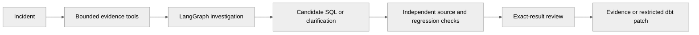

<p align="center"></p>

<p align="center"><a href="https://github.com/Akhilesh-Vangala/verifyops/actions/workflows/checks.yml"></a> &nbsp; Python · LangGraph · FastAPI · PostgreSQL</p>

# VerifyOps

**Investigate. Repair. Verify.** Evidence-backed SQL incident analysis with independent regression checks and a real dbt repair pipeline.

[**Open the app ↗**](https://verifyops.vercel.app/demo) · [**Watch the recording ↗**](https://verifyops.vercel.app/demo/recording) · [Technical documentation](docs/README.md) · [Repository layout](docs/development/LAYOUT.md)

## The business problem

Investigate a business-metric discrepancy, propose a SQL repair, and challenge it against independently computed references before accepting the result.

<a id="the-operator-workbench"></a>
<a id="see-the-workbench"></a>

## Run the workflow

<picture>
  <source media="(prefers-reduced-motion: reduce)" srcset="docs/assets/demos/verifyops-interactive-poster.png">
  
</picture>

**Actual execution, guided synthetic data.** The continuous recording shows real browser interactions and server results. No live model call, customer data or user-validation claim. [Recording provenance and reproducible capture](docs/DEMO.md).

Six original synthetic incidents. Run the fixed diagnostic, inspect source evidence, edit SQL, rerun independent regressions and review the exact checked result. Incorrect repairs cannot be accepted. No production warehouse writes or repository merges occur.

<a id="inside-the-agent"></a>
<a id="the-agentic-workflow"></a>
<a id="a-real-dbt-repair-workflow"></a>
<a id="what-is-engineered-here"></a>

<a id="operational-controls"></a>

## Architecture and authority


A checkpointed LangGraph investigator uses bounded evidence tools and public corrective feedback. Independent SQL verification and a real dbt workflow check restricted patches across five fixtures and four output relations. PostgreSQL coordinates separate workers and optional graph checkpoints; workspace files still require shared same-node storage.



| Component | Owned responsibility |
| --- | --- |
| Frontend | Native monochrome browser UI, persistent detail URLs, evidence/review views, session history, exports and the recording player. |
| Backend | FastAPI routes, typed domain contracts, LangGraph orchestration, version/review gates and controlled synthetic execution. |
| Independent checking | Independent source computations, evidence replay, regression snapshots and restricted dbt patch checks. |
| Persistent runtime | PostgreSQL queue and separate leased workers; same-node fixture/workspace artifacts remain an explicit boundary. |
| Public demo | Request-bounded synthetic execution with browser-session history. Live inference and persistent cloud workers are separate. |

## Repository layout

```text
verifyops/
├── backend/
│   ├── src/vdir/
│   ├── tests/
│   ├── requirements/
│   ├── docker/
│   ├── data/
│   ├── agents/investigator/
│   └── dbt/revenue_incident/
├── frontend/
│   └── apps/
│       ├── demo/
│       │   └── assets/
│       │       ├── scripts/
│       │       ├── styles/
│       │       └── media/
│       └── workbench/
│           └── assets/
│               ├── scripts/
│               └── styles/
├── infrastructure/
│   ├── containers/
│   ├── kubernetes/
│   └── terraform/
├── scripts/
│   ├── checks/
│   ├── demos/
│   ├── deployment/
│   └── development/
├── docs/
│   ├── architecture/
│   ├── operations/
│   ├── evaluation/
│   ├── project/history/
│   └── assets/
│       ├── branding/
│       ├── diagrams/
│       ├── screenshots/
│       └── demos/
└── .github/
```

[Component ownership and commands](docs/development/LAYOUT.md) · [Current handoff](docs/project/HANDOFF.md) · [Release plan](docs/project/PLAN.md)

<a id="run-it"></a>

## Run locally

```sh
git clone https://github.com/Akhilesh-Vangala/verifyops.git
cd verifyops
python3.12 -m venv .venv
.venv/bin/python -m pip install -r backend/requirements/development.txt
python3.12 -m venv .venv-dbt
.venv-dbt/bin/python -m pip install -r backend/requirements/dbt.txt
PYTHONPATH=backend/src .venv/bin/python -m vdir.cli.serve
```

Open **http://127.0.0.1:8000**. The local workbench uses original synthetic data and no provider key is needed for scripted checks. dbt has a separate dependency environment.

Python 3.11–3.12 is supported; CI and containers use 3.12. Keep private configuration in ignored `.env`; never overwrite an existing private configuration. [Full development and deployment guide](docs/operations/DEVELOPMENT.md).

<a id="verified-evidence"></a>
<a id="evidence-honestly-scoped"></a>

<a id="reproduce-checks-and-evaluation"></a>

## Engineering evidence

| Scope | Evidence |
| --- | --- |
| Test coverage | 147 unit/integration cases; local PostgreSQL/dbt cases skip without their configured tooling. Dedicated CI executes actual dbt integration, browser workflows, runtime images, Terraform validation and Kind. |
| Known synthetic regression | 38 known fixed-diagnostic cases; five dbt fixtures × four output relations check the repair, including a plausible false fix. |
| Actual browser | Investigation, evidence/SQL, verification, download, reload/history, mobile layout and the native recording player. |
| Live model quality | **Not evaluated.** Public demos force guided mode; native transport tests use controlled providers. |
| Customer production | **Not certified.** Monitored persistent cloud delivery, individual/tenant authority where applicable and actual-user feedback remain release gates. |

```sh
PYTHONPATH=backend/src VDIR_LOAD_DOTENV=0 python -m unittest discover -s backend/tests -v
PYTHONPATH=backend/src VDIR_LOAD_DOTENV=0 python backend/tests/e2e/browser_smoke.py
python scripts/demos/public_demo_browser.py
python scripts/checks/check_repository.py
```

Native commands run inside the project's installed environment. Required CI repeats the relevant checks on Linux. Test counts describe distinct cases; rerunning them in a container does not double the number of tests. [Evaluation and limits](docs/evaluation/README.md) · [Progress and source-linked evidence](docs/project/PROGRESS.md).

## Operating modes and limits

- **Guided public app:** real calculations over original synthetic fixtures; no paid generation. Signed anonymous review branches can be replayed/forked until expiry, so the public sandbox is not an immutable shared approval ledger or global exactly-once executor.
- **Private agent/runtime:** official Anthropic SDK, typed tools and bounded agent loops. A private provider key and explicit live selection are required; live quality and cost comparisons remain unmeasured.
- **Production boundary:** business-state/workspace files remain same-node; individual identity, per-run isolation, real connectors and monitored persistent cloud operation are open.

[Design decisions](docs/DECISIONS.md) · [Recorded demo](docs/DEMO.md) · [Branch policy](docs/development/BRANCHING.md) · [Contributing](.github/CONTRIBUTING.md) · [Dated history](docs/project/history/PRE-ORGANIZATION-README.md)
