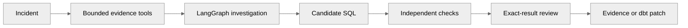

<p align="center"></p>

**Investigate. Repair. Verify.** [Open VerifyOps](https://verifyops.vercel.app/) · [Upload your data](https://verifyops.vercel.app/uploads) · [Docs](docs/README.md)

<p align="center"><a href="https://github.com/Akhilesh-Vangala/verifyops/actions/workflows/checks.yml"></a> &nbsp; Python · LangGraph · FastAPI · PostgreSQL</p>

# VerifyOps

Evidence-backed SQL incident investigation with checkpointed LangGraph, independent regression checks, and a real dbt repair pipeline — so a metric discrepancy gets a proposed fix that cannot be accepted until checks pass.

[**Open the app ↗**](https://verifyops.vercel.app/) · [Technical documentation](docs/README.md) · [Repository layout](docs/development/LAYOUT.md)

## Architecture




| Component | Responsibility |
| --- | --- |
| Frontend | Landing, guided intake, report views, device projects/history |
| Backend | FastAPI, typed contracts, LangGraph orchestration, review gates |
| Independent checking | Source computations, regressions, restricted dbt patch checks |
| Runtime | PostgreSQL workers; fixtures/workspace remain same-node |

## Repository layout

```text
verifyops/
├── backend/          src, tests, agents, dbt, data
├── frontend/         demo, product, uploads, workbench
├── infrastructure/   containers, kubernetes, terraform
├── scripts/
├── docs/
└── .github/
```

## Run locally

```sh
git clone https://github.com/Akhilesh-Vangala/verifyops.git
cd verifyops
python3.12 -m venv .venv
.venv/bin/python -m pip install -r backend/requirements/development.txt
PYTHONPATH=backend/src .venv/bin/python -m vdir.cli.serve
```

Open **http://127.0.0.1:8000**. [Full development guide](docs/operations/DEVELOPMENT.md).

## Checks

```sh
PYTHONPATH=backend/src VDIR_LOAD_DOTENV=0 python -m unittest discover -s backend/tests -v
python scripts/checks/check_repository.py
```

Public demos use guided synthetic fixtures (no live inference claim). Live model quality and customer production certification remain out of scope. [Evaluation](docs/evaluation/README.md) · [Demo notes](docs/DEMO.md)
