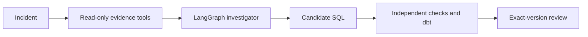

# VerifyOps

A checkpointed LangGraph investigator proposes a SQL repair for a metric discrepancy. Independent regression checks and a real dbt pipeline decide whether that repair can be accepted. The model does not grade its own fix.

[Open the app](https://verifyops.vercel.app/) · [Upload a file](https://verifyops.vercel.app/uploads) · [Architecture](docs/architecture/OVERVIEW.md) · [Evaluation](docs/evaluation/README.md) · [Decisions](docs/DECISIONS.md) · [Run locally](docs/operations/DEVELOPMENT.md)

Python 3.12 · LangGraph · Anthropic SDK · FastAPI · PostgreSQL · DuckDB · dbt · OpenTelemetry · Kubernetes · [CI](https://github.com/Akhilesh-Vangala/verifyops/actions/workflows/checks.yml)

## Architecture

Read-only evidence tools feed the agent. A separate verifier runs source computations and dbt builds. An operator accepts or rejects that exact checked version.



| Layer | Where | Responsibility |
| --- | --- | --- |
| Frontend | `frontend/` | Product workspace, guided sandbox, operator workbench |
| Agent | `agent/investigator/` | LangGraph loop, tools, model transport. Proposes SQL. Cannot accept it. |
| Backend | `backend/` | FastAPI, jobs, independent verification, dbt, review |
| Infrastructure | `infrastructure/` | Compose, Kustomize base and overlays, AWS Terraform |

## How a repair is accepted

1. The worker exports the current snapshot, schema, contract, lineage, and SQL into an isolated workspace. Regression snapshots and reference computations stay behind.
2. The investigator gathers evidence through six allowlisted read-only tools. SQL is parsed by SQLGlot and runs in DuckDB with external access disabled, plus row, column, cell, byte, memory, and time limits.
3. A repair must cite an executed query that matches a test in the latest hypothesis plan. A public precheck validates execution, output shape, and completeness.
4. The verifier replays the evidence trace to reject fabricated results, then runs the candidate against independent Python references on private snapshots.
5. dbt repairs are limited to one upstream model and plain `SELECT` SQL. They are built and tested across five fixtures and four output relations, which gives 20 model checks.
6. Review binds an immutable SHA-256 version of source, SQL, evidence, and grading. Edited SQL becomes a new verification job. Approval of a failed or stale version is rejected.

## Agent controls

- **Checkpointed graph.** Prepare, model, evidence, plan, decision, and clarification are separate transitions with SQLite or PostgreSQL checkpoints.
- **Call receipts.** Each provider call is reserved before execution and persisted before the graph commit. An unresolved call blocks replay, so a crash cannot silently bill twice.
- **Bounded correction.** Strict Pydantic schemas; two structured corrections per run; findings must cite executed evidence IDs.
- **Spend admission.** Worst-case cost is reserved atomically against a shared ledger before each generation. Defaults are $1 per run and $5 per ledger. Unknown usage keeps its reservation.
- **Clarification.** Missing authority, such as an absent timezone offset or conflicting event payloads, pauses the run for operator guidance. A continuation is an exact-version child.

## Durable execution

PostgreSQL owns queue admission, idempotency, leases, reviews, and LangGraph checkpoints. Advisory locks serialize admission, `FOR UPDATE SKIP LOCKED` distributes claims, and every publication checks lease ownership. Workers supervise subprocess groups and stop and reap them on cancellation, shutdown, or lease loss. Kubernetes runs separate migration, API, and worker roles. CI deploys them to Kind with two competing workers. [Runtime](docs/operations/PRODUCTION-FOUNDATION.md).

## Evaluation

| Check | Result |
| --- | --- |
| Native suite | 202 tests; CI runs the PostgreSQL cases, and the real dbt case runs in its own job |
| Browser journeys | 96 checks across four workbench journeys, 24 dbt checks, repeated inside the test container |
| Fixed diagnostic baseline, 38-case corpus | Pass@1 1.0 on DuckDB (114 attempts) and on SQLite |
| dbt repair | 20 of 20 model checks; daily revenue restored from 2400 to 1200 cents |
| Plausible false fix | Equal-value deduplication passes the incident and is rejected by regression |

[Scoring and corpus](docs/evaluation/BENCHMARK.md) · [Case study](docs/architecture/CASE-STUDY.md).

## Repository layout

```text
frontend/apps/          product, demo, workbench, uploads recording
agent/investigator/     LangGraph loop, tools, model transport
backend/src/vdir/       api, workers, persistence, workflows, verification, evaluation
backend/dbt/            restricted repair project
backend/tests/          unit, integration, browser journeys
infrastructure/         containers, kubernetes, terraform, supabase
scripts/                checks, demos, deployment
```

## Run locally

```sh
git clone https://github.com/Akhilesh-Vangala/verifyops.git
cd verifyops
python3.12 -m venv .venv
.venv/bin/python -m pip install -r backend/requirements/development.txt
PYTHONPATH=backend/src .venv/bin/python -m vdir.cli.serve
```

Open **http://127.0.0.1:8000**. The full stack with PostgreSQL, Phoenix, API, and worker runs with `scripts/deployment/compose.sh up --build --wait`. [Development guide](docs/operations/DEVELOPMENT.md).

## Checks

```sh
PYTHONPATH=backend/src VDIR_LOAD_DOTENV=0 python -m unittest discover -s backend/tests -v
PYTHONPATH=backend/src python -m vdir.evaluation.benchmark --output artifacts/generated/benchmark --samples 1
python scripts/checks/check_repository.py
```

CI runs three required jobs: native tests with PostgreSQL and browsers, the container build with Terraform validation and the Kind smoke, and a dedicated dbt integration job.
