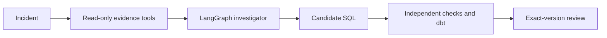

# VerifyOps

A checkpointed LangGraph investigator proposes a SQL repair for a metric discrepancy. Independent regression checks and a real dbt pipeline decide whether that repair can be accepted. The model does not grade its own fix.

[Open the app](https://verifyops.vercel.app/) · [Upload a file](https://verifyops.vercel.app/uploads) · [Architecture](docs/architecture/OVERVIEW.md) · [Evaluation](docs/evaluation/README.md) · [Run locally](docs/operations/DEVELOPMENT.md)

Python · LangGraph · FastAPI · PostgreSQL · [CI](https://github.com/Akhilesh-Vangala/verifyops/actions/workflows/checks.yml)

## Architecture

Read-only evidence tools feed the agent. A separate verifier runs source computations and dbt builds. An operator accepts or rejects that exact checked version.



| Layer | Where | Responsibility |
| --- | --- | --- |
| Frontend | `frontend/` | Landing, guided intake, report views, device projects |
| Agent | `agent/investigator/` | LangGraph loop and tools. Proposes SQL. Cannot accept it. |
| Backend | `backend/` | FastAPI, jobs, independent checks, dbt, review |

## Repository layout

```text
frontend/             demo, product, uploads, workbench
agent/investigator/   LangGraph loop, tools, model transport
backend/              API, jobs, verification, dbt, data
```

## Run locally

```sh
git clone https://github.com/Akhilesh-Vangala/verifyops.git
cd verifyops
python3.12 -m venv .venv
.venv/bin/python -m pip install -r backend/requirements/development.txt
PYTHONPATH=backend/src .venv/bin/python -m vdir.cli.serve
```

Open **http://127.0.0.1:8000**. [Full development guide](docs/operations/DEVELOPMENT.md).

## Checks

```sh
PYTHONPATH=backend/src VDIR_LOAD_DOTENV=0 python -m unittest discover -s backend/tests -v
python scripts/checks/check_repository.py
```
