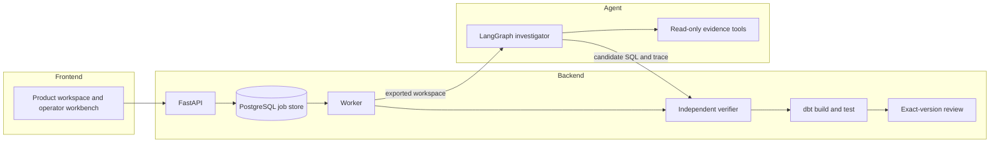

# SQLArbiter

SQLArbiter investigates business-metric discrepancies and repairs the SQL that caused them. A checkpointed LangGraph agent gathers evidence through read-only tools and proposes a fix. An independent verifier and a real dbt pipeline decide whether that fix is correct. The agent never grades its own output, and an operator approves only the exact version that passed.

**Live:** https://sqlarbiter.vercel.app

## Architecture



| Component | Path | Responsibility |
| --- | --- | --- |
| Frontend | `frontend/apps/` | Product workspace, guided sandbox, operator workbench. Native ES modules, no build step. |
| Agent | `agent/investigator/` | LangGraph state machine, evidence tools, async model transport, call receipts. Flat imports so it runs without backend or evaluator code. |
| Backend | `backend/src/sqlarbiter/` | API, job store, worker, verification, evaluation, dbt workflow, spend ledger, telemetry. |
| dbt project | `backend/dbt/revenue_incident/` | Restricted repair target with five regression fixtures. |
| Infrastructure | `infrastructure/` | Compose topology, Kustomize base with `kind` and `aws` overlays, AWS Terraform, Supabase migration. |

## Verification pipeline

1. **Export.** The worker writes the current snapshot, schema, contract, lineage, change log, and SQL into an isolated workspace. Regression snapshots and reference computations are never exported.
2. **Investigate.** The agent queries evidence through ten allowlisted read-only tools. Every result gets a content-addressed evidence ID.
3. **Plan and cite.** A repair must cite a successful, complete query whose SQL matches a test in the latest hypothesis plan.
4. **Precheck.** Public SQL prechecks validate execution, output schema, and completeness before submission.
5. **Replay.** The verifier replays the evidence trace and rejects any result the tools did not produce.
6. **Grade.** Candidate SQL runs against independent Python reference computations on private snapshots. Schemas and values must match exactly.
7. **Build.** dbt repairs build and test across five fixtures and four output relations, giving 20 model checks.
8. **Review.** Approval binds a SHA-256 version of the source, SQL, evidence, and grading. Edited SQL becomes a new verification job. A failed or stale version cannot be approved or downloaded.

## Agent design

| Mechanism | Implementation |
| --- | --- |
| State machine | LangGraph `StateGraph` with separate prepare, model, evidence, plan, decision, and clarification nodes |
| Checkpoints | `AsyncSqliteSaver` offline, `AsyncPostgresSaver` with one stable thread per job |
| Call receipts | Each provider call is reserved before execution and persisted before the graph commit, so a crash never replays a billed call |
| Structured output | Strict Pydantic schemas for plans, findings, and decisions. Findings are at most 480 characters and cite 1 to 4 evidence IDs |
| Correction | At most 2 structured corrections per run, with feedback from public checks only |
| Working memory | Latest plan, findings, and the 12 most recent evidence IDs appended to the counted system prompt |
| Clarification | Missing authority pauses the run. Continuation creates an exact-version child from committed checkpoint state |
| Spend admission | Worst-case cost reserved atomically in a shared ledger before each generation. Defaults are $1 per run and $5 per ledger. Retries disabled |
| Versioning | Source, code, and package fingerprints are checked on resume. A changed fingerprint fails closed |

## Execution and durability

- **Admission.** Idempotency keys of 8 to 128 characters. Repeating a key with a different body returns `409`. At most 16 active jobs.
- **Claims.** `FOR UPDATE SKIP LOCKED` across competing workers, with advisory transaction locks around admission.
- **Leases.** 300-second leases. Every progress write and result publication checks lease ownership, so a stale or cancelled worker cannot publish.
- **Cancellation.** Subprocess groups are supervised and get TERM, then KILL, and are reaped. dbt subprocesses are capped at 90 seconds and 2 MB of logs. A queued dbt workflow has a 600-second deadline.
- **Recovery.** Expired jobs become `interrupted` and are never retried automatically.
- **Topology.** Kubernetes base runs 2 API and 3 worker replicas, plus a migration Job, PodDisruptionBudgets, API autoscaling, and default-deny network policy. Pods run as UID 10001 with a read-only root filesystem and dropped capabilities.

## Execution limits

| Limit | Value |
| --- | --- |
| Rows returned per query | 100 (truncation detected) |
| Columns per result | 50 |
| Characters per cell | 256 |
| Tool result size | 32,768 bytes |
| DuckDB | 1 thread, 128 MB, external access and extensions disabled |
| SQL surface | SQLGlot allowlist of `SELECT`, tables, and functions |
| Candidate SQL | 50,000 characters |
| Request body | 75 KB for the API, 1 MB for uploads |
| Upload | 400,000 bytes, 60 columns, 5,000 rows |

## Results

From the CI run on `main`:

| Check | Result |
| --- | --- |
| Native test suite | 202 tests passed |
| Browser journeys | 96 checks: 31 investigation, 20 graph, 23 workflow, 22 page |
| dbt browser journey | 24 checks |
| dbt repair | 20 of 20 model checks. Daily revenue restored from 2400 to 1200 cents |
| False repair | Equal-value deduplication passes the original incident and is rejected by regression |
| Benchmark, 38 cases, fixed diagnostic | Pass@1 1.0, SQL execution Pass@1 1.0 |
| Benchmark outcomes | 27 verified repairs, 9 no-change, 2 clarifications |
| Benchmark cost | 7.92 tool calls, 0.25 s investigation, and 1.21 s verification per case |
| Container | Same suites inside the test image, plus the runtime image build |
| Deployment | Terraform validate, all Kustomize renders, Kind smoke with two competing workers |

The corpus has six controls and 32 variants across join fan-out, outer-join nulls, eligibility-filter omissions, and UTC boundaries, in eight SQL-shape templates with calibration and evaluation splits. Pass@k is computed as \(1 - \binom{n-c}{k} / \binom{n}{k}\).

## Stack

| Area | Technology |
| --- | --- |
| Agent | LangGraph 1.2.14, Anthropic SDK 1.12.0, Pydantic 2.13.5 |
| API | FastAPI 0.128.8, Uvicorn 0.39.0 |
| Data | PostgreSQL 17, psycopg 3.3.6, DuckDB 1.5.6, SQLGlot 30.21.0, SQLite |
| Transformation | dbt-core 1.12.5, dbt-duckdb 1.11.0 |
| Observability | OpenTelemetry 1.45.1, OTLP, Phoenix |
| Deployment | Docker, Kubernetes, Kustomize, Kind, Terraform 1.16.5, AWS EKS, RDS, EFS, S3, ECR, KMS, Vercel |
| Testing | unittest, Playwright with Chromium, axe-core 4.14.0 |

## Repository layout

```text
frontend/apps/          product, demo, workbench, uploads
agent/investigator/     graph, agent_policy, model, tools, engines, baseline, spending, telemetry, worker
backend/src/sqlarbiter/       api, workers, persistence, workflows, verification, evaluation, domain, platform, uploads, product, cli
backend/dbt/            revenue_incident project
backend/data/           benchmark manifests, contract, pricing
backend/tests/          api, agents, verification, persistence, workflows, e2e, fixtures
infrastructure/         containers, kubernetes, terraform, supabase
scripts/                checks, demos, deployment
docs/                   architecture, product, operations, evaluation, development
```

The [documentation index](docs/README.md) covers the agent, jobs, dbt repair, product workspace, deployment and evaluation in detail.

## Quick start

```sh
git clone https://github.com/Akhilesh-Vangala/sqlarbiter.git
cd sqlarbiter
python3.12 -m venv .venv
.venv/bin/python -m pip install -r backend/requirements/development.txt
PYTHONPATH=backend/src .venv/bin/python -m sqlarbiter.cli.serve
```

The server listens on `127.0.0.1:8000`. For the full stack with PostgreSQL, Phoenix, migrations, API, and worker:

```sh
cp .env.example .env
scripts/deployment/compose.sh up --build --wait
```

## Testing

```sh
PYTHONPATH=backend/src SQLARBITER_LOAD_DOTENV=0 python -m unittest discover -s backend/tests -v
PYTHONPATH=backend/src python -m sqlarbiter.evaluation.benchmark --output artifacts/generated/benchmark --samples 1
python scripts/checks/check_repository.py
```

CI has three required jobs on every pull request: `tests` (PostgreSQL service, unit and browser suites, benchmark), `container` (test and runtime images, Terraform, Kustomize, Kind), and `dbt` (real dbt integration and browser journey).
