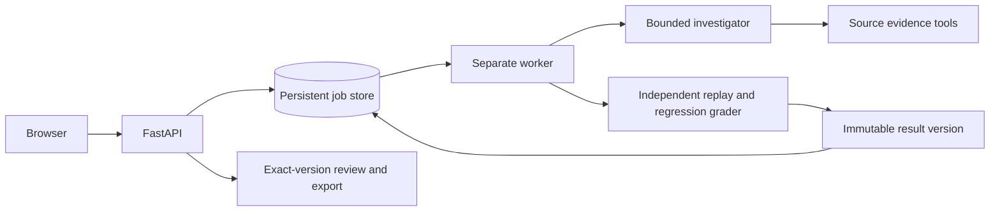

# Architecture

October 8: [graph findings, multi-metric workflow admission, worker cancellation and new workflow pages](12-WORKFLOWS-AND-CANCELLATION.md) are implemented and verified with 109 unit / 74 browser checks locally and in Linux containers. State is still single-host, and live model quality remains unmeasured. Earlier milestone evidence below is preserved.

Implemented: evaluator-owned incident → exported current source/schema/contract/lineage/change evidence → standalone fixed or model investigator → bounded DuckDB or SQLite analytical tools → evidence-cited decision → evaluator replays trace → independent source reference/regression checks → saved JSON report.

References calculate from source records without executing candidate SQL. Ambiguous reference sources raise evaluator errors; patches are judged by output meaning, not exact SQL matching.

The exported runtime imports no evaluator package and has no expected results, regression snapshots or fault labels. Async SDK model tool calls expose only contract, describe, profile, lineage, changes, current_sql and query; finish submits a decision. The fixed baseline and model share these tools and authority.

The implemented product adds a FastAPI API, original browser interface, persistent local job state and a separate worker. Admission/idempotency, atomic job ownership, renewable leases, saved traces/results, candidate revision checks and immutable exact-version review live outside model authority. [Web/job interfaces](09-WEB-AND-JOBS.md).

Implemented: selectable LangGraph investigator with local persistent graph checkpoints/call receipts and explicit clarification continuation. Independent verification and job ownership remain outside agent control; [graph/recovery details](11-AGENT-ORCHESTRATION.md). Planned: learned policy, OS-isolated verification, PostgreSQL state/object artifacts and distributed recovery. Temporal remains conditional on clear recovery ownership. AWS proposed, GPU training/serving separate. Current SQLite queue/checkpointer are single-host development infrastructure.

The graph's version-2 policy layer separates structured planning, decision validation, public SQL prechecks and bounded correction feedback into explicit nodes. Pydantic models validate public task artifacts; repairs require a cited executed plan test. Precheck query receipts share existing tool/time limits and survive checkpoint crashes. Activity/assessment is attached to exact results; edited operator revisions remove stale agent metadata. This improves reviewable orchestration, not model intelligence or production deployment readiness.

The investigator subprocess runs with isolated Python imports and an explicit environment. Model mode alone receives its provider configuration. This is not OS isolation: arbitrary Python still has host filesystem authority, and the fixed workflow runtime itself contains handcrafted repair logic. Models cannot read runtime files through the provided tools. Production requires container/filesystem/network/credential boundaries.

OpenTelemetry propagates job/investigation/tool/verification trace context across the subprocess boundary. Model rounds add durations/usage when invoked. JSONL spans are local; optional OTLP exports metadata to the tested Phoenix collector. [Engine/query budgets and executed infrastructure](10-REMEDIATION-AND-BENCHMARK.md).
