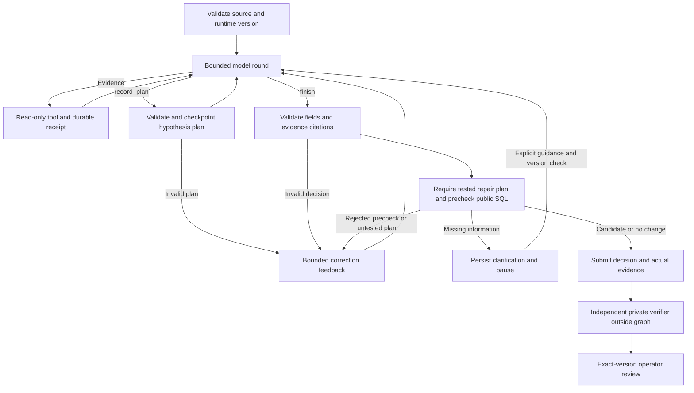

# LangGraph investigator

October 8 current owned workflow: **vdir-graph-3**, unchanged package versions, dedicated strict findings node and bounded public working memory. Added SQL inspection/equality-join profiles, cited interpretations exposed in Agent activity and fresh-controller findings continuation tests. **109 unit / 31 existing browser / 20 scripted graph browser / 23 automation browser checks pass locally and in Linux Docker**; live model quality remains unmeasured. Old graph-2 checkpoints require new runs; completed results remain readable. [Current design and limits](12-WORKFLOWS-AND-CANCELLATION.md). The following graph-2 milestone remains history, superseded as current status.

October 7, 2026. **Implemented locally following explicit user authorization.** LangGraph 1.2.14, checkpoint 4.2.0 and SQLite checkpointer 3.1.1 are installed/pinned. Select `langgraph` in the app/API/CLI/benchmark alongside `baseline` and `anthropic`. The fixed workflow remains the default. MCP, Temporal and PydanticAI remain proposals. Live model quality remains unmeasured: no private provider key is configured.

Latest user direction: “also improve the agentic framework”. The owned workflow is now **vdir-graph-2**; the installed LangGraph version is unchanged. Added strict Pydantic 2.13.5 hypothesis plans, executed-test requirements for repairs, public SQL prechecks, bounded correction feedback and a checkpointed activity record exposed in the app. **89 unit / 21 workflow browser / 18 graph browser checks pass locally and in the Linux ARM64 test container**. Current packaging evidence is below; earlier graph-1 container counts are historical.

## Purpose and boundary

Implemented `StateGraph` in investigator_runtime/graph.py: prepare a bounded model round → invoke the official async SDK → route to checkpointed evidence, structured planning or decision validation → public SQL precheck → submit, correct or interrupt for guidance. It reuses existing evidence tools, independent verifier, review service and evaluation runner. `graph.plan`, `graph.precheck` and `graph.feedback` join existing model/tool spans through OTel/Phoenix. Pydantic schemas live in investigator_runtime/agent_policy.py, exported without evaluator code. This uses conditional workflow gates, following [official workflow patterns](https://docs.langchain.com/oss/python/langgraph/workflows-agents), rather than adding separate model agents without measured value.



The graph may nominate SQL and cite evidence. It cannot access private regression sources/reference functions, set verification success, approve a repair or execute production writes. Evidence replay and separate verification remain authoritative. Operator guidance is untrusted context, not new authoritative source data. A changed contract/source requires a new incident version; missing offsets/conflicting source values remain unresolved until their authoritative data exists.

## State and ownership

Implemented state contains evidence/code/package version, bounded provider messages, public evidence trace, repeat counters, rounds, token usage/provider preflight counters, active call time, pending calls/replies, validated decision, model metadata, structured plan revisions, correction count, public assessment and activity journal. Plans contain concise falsifiable task hypotheses and tests, not private internal reasoning. No provider secrets or evaluator answers are checkpointed. Current traces fit existing tool/row/column/cell/byte caps; external artifact storage and retention remain release work.

## Planning and bounded correction

The graph-only `record_plan` tool accepts a bounded objective, one to three hypotheses with unique h1–h3 IDs, concise claim/expected signal and a SQL test, plus unique existing successful evidence IDs. Strict Pydantic models reject coercion, extra fields, overlong values and invalid shapes; separate checks validate citations and unique IDs. A maximum of three revisions is checkpointed. Plans are public proposals and do not certify their claims. A repair must have a plan and cite at least one successful, complete query whose SQL matches a test in its latest plan. Plans can incorporate already observed tests; this is not proof that planning preceded evidence collection. Healthy no-change and clarification outcomes need no repair plan.

Invalid plans/decisions, unsupported SQL execution, incomplete output and output-schema errors produce structured tool feedback. The same investigator may correct them at most **twice total**, within the original **eight model rounds / 24 evidence calls / 12,000 output tokens / counted context / 240 active call seconds**. Planning uses model rounds but creates no source evidence. The counter survives checkpoints, crashes and guidance; no budgets are reset. Invalid provider envelopes/IDs/names, unresolved call receipts and hard resource limits still fail closed. Feedback includes public issues only; private regressions/reference answers are unavailable.

## Public precheck versus independent verification

Candidate and no-change submissions must execute safely, completely and with exact contract output columns on the current public snapshot. An existing successful identical query may be reused; otherwise the controller executes one bounded evidence query, journals its receipt before checkpoint commit and charges it to the same tool/time budget. The actual query evidence ID is included in the submitted decision. Rejected SQL/partial/wrong-shaped outputs cannot finish successfully; an operator clarification submits no SQL.

This checks execution, columns and completeness, **not business correctness**. A query with correct columns and wrong aggregation can pass this stage and fail the independent verifier. Tests explicitly demonstrate that boundary. The private verifier still replays every actual tool call and checks source references/regression snapshots. Operator approval remains an exact-version human action outside the graph.

Completed/paused results expose `agent_workflow` (plan revisions, activity, correction count and public precheck) in JSON exports and the app's **Agent activity** tab. Entries are recorded node events, not fabricated live progress. Manually edited SQL revisions remove inherited workflow/model/graph metadata, so a prior agent assessment is never presented as checking a different SQL version.

`AsyncSqliteSaver` writes graph-checkpoints.sqlite with synchronous checkpoint durability between transitions. The separate graph-receipts.sqlite journal reserves each call before execution and persists completed results before the graph commit. Both are local development state; PostgreSQL remains the release proposal. [Official persistence guide](https://docs.langchain.com/oss/python/langgraph/persistence).

The job service owns admission, leases and review; LangGraph owns investigation transitions. A `needs_information` decision interrupts the graph and is independently checked before the app records a `paused` result. POST `/api/jobs/{id}/resume` accepts the exact `parent_version` and 1–2000 characters of `guidance`, with the existing authentication/origin/body/idempotency controls. A transaction allows one child continuation per parent. The worker clones public evidence and committed SQLite state using database backup, then resumes the child. The parent result/version stays immutable; its audit records the child. Repeated identical submissions reuse the same child, while competing/stale submissions fail.

Restored budgets include consumed rounds, tools/repetitions, reported tokens, counted provider input context and active call time; human waiting does not consume the call-time budget. Recovery reuses completed receipts if a process died before its graph checkpoint. An unresolved receipt blocks replay: a provider may already have completed/billed, so no exactly-once billing guarantee is made. Failed metadata records successful receipt usage and unknown additional billing. Expired app jobs retain the existing interrupted/no-automatic-retry policy; app continuation currently supports paused graphs only. Standalone recovery is explicit and does not claim application lease recovery.

## Run and continue

Enter the private provider key/model in ignored .env. The app enables LangGraph when configured; no key is shown in browser configuration. Example live commands from the project directory (billable):

```sh
PYTHONPATH=src .venv/bin/python -m vdir --investigate artifacts/generated/live-graph-six --investigator langgraph --engine duckdb
PYTHONPATH=src .venv/bin/python -m vdir.benchmark --output artifacts/generated/live-graph-benchmark --investigator langgraph --samples 1
```

The app's paused result offers an investigation guidance field and Resume investigation button. Changing source data requires a new incident. Standalone exported CLI runs may be explicitly recovered/continued (these commands return an investigator response; they do not independently grade the continuation):

```sh
PYTHONPATH=src .venv/bin/python -m vdir.graph_resume --workspace artifacts/generated/live-graph-six/case-003/evidence --guidance-file /path/to/guidance.txt
PYTHONPATH=src .venv/bin/python -m vdir.graph_resume --workspace artifacts/generated/standalone-interrupted/evidence --recover
```

Use the app API for app-owned jobs so admission/ownership/audit rules remain enforced. Graph version, installed framework/provider versions, source bytes and exported code are checked on resume. Checkpoint migration is deliberately unsupported; changed versions require a new run.

Version 2 changes the owned graph state/prompt/runtime fingerprint. Existing version-1 checkpoints are intentionally rejected on continuation, while their stored results remain readable. Start a fresh investigation; no historical jobs/checkpoints are deleted or silently migrated.

## Acceptance evidence

Current local evidence: **89 unittest / 21 workflow browser / 18 graph browser checks pass**. Ten new unit tests cover plan validation and grounding, unexecuted-test rejection, correcting invented citations/invalid SQL, incomplete/incorrect output shapes, SQL-precheck receipt recovery, wrong semantics failing independent grading, preserved plans/activity and retained correction limits after crash. Existing SDK streaming test verifies the graph-specific system prompt is counted and sent, plus precheck spans. Six scripted scenarios still pass independent grading in both engines; planned browser repair/continuation/revision flows pass with a scripted provider. Browser artifacts: browser-smoke-904bd6f4 and browser-graph-19a63c9c; plan/paused desktop/mobile screenshots inspected. Live model improvement is unmeasured.

Executed graph-2 Linux ARM64 validation also passes **89 unit / 21 workflow browser / 18 graph browser checks**; the container exits 0. Fixed benchmark **38/38**, runtime hash matches current source. Rebuilt Compose API/worker passes six baseline investigations/reviews/exports. Evidence: artifacts/generated/agent-framework-001/summary.json plus logs/benchmark/report, gathered by setup/command-records/2026-10-07-agent-framework-evidence.py. The first build ran out of guest disk; removed completed project test containers/obsolete test images and unused build cache, retaining Compose data volumes. No host credentials were copied. These demonstrate packaging/integration, not live AI quality or cloud readiness.

The following records the earlier graph-1 integration milestone, not verification of changed source:

Local verification: **79 unittest checks**, **13 existing browser workflow checks**, **11 graph browser checks**. Tests cover abrupt process death and recovery in a new isolated Python process; model/tool result-to-checkpoint crash windows; unresolved request replay blocking; retained context/round/tool/repetition/output limits; source changes; clarification reopen; concurrent/stale/duplicate continuations; immutable parent results; private evaluator data/credentials absent from checkpoints; and real SDK SSE assembly with mocked HTTP. All six scripted scenarios pass the independent verifier in both SQL engines. These are integration/protocol tests, not live AI accuracy. Generated evidence is under browser-smoke-cf6fe2ec, browser-graph-035a1034 and langgraph-integration-001. Container evidence is recorded after execution in the project progress/handoff.

Executed Linux ARM64 validation also passes **79 unit, 13 existing browser and 11 graph browser checks**. Rebuilt Compose runtime passed six baseline workflows/reviews/exports; the fixed container benchmark passed 38/38 with a matching current runtime hash. Evidence: artifacts/generated/langgraph-integration-001/summary.json and logs. No host credentials were copied into the guest. These container results demonstrate packaging/integration, not model quality or cloud readiness.

Remaining: live matched controller/graph evaluation, real fault diversity, PostgreSQL/distributed ownership, checkpoint retention/migration policy, OS isolation, identity, full app interrupted-job recovery and cloud delivery. No default switch or production-readiness claim follows from installing the framework.

MCP is a later scoped external-connector protocol, subject to the same authorization/result controls; [architecture](https://modelcontextprotocol.io/docs/2026-07-28/learn/architecture). Temporal is conditional distributed workflow infrastructure; assign one recovery/approval authority and test side-effect retries before combining it with graph checkpoints; [workflow/replay guide](https://docs.temporal.io/workflow-execution). PydanticAI is an alternative typed agent implementation to compare if controller complexity warrants it; [overview](https://pydantic.dev/docs/ai/overview/).
