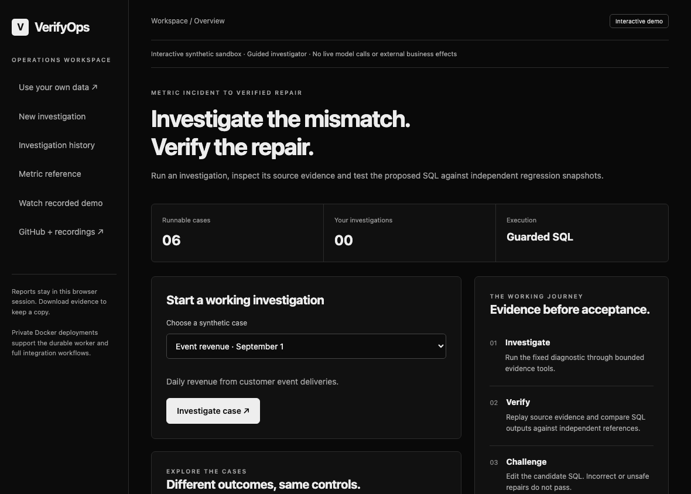

# VerifyOps recorded demonstration

[Open the working app](https://verifyops.vercel.app/demo) · [Watch the continuous recording](https://verifyops.vercel.app/demo/recording) · [Download the WebM](../frontend/apps/demo/assets/media/walkthrough.webm) · [Capture/source manifest](demos/interactive-recording.json)



The GIF is a six-frame preview. The WebM is a continuous Playwright screen recording of real browser interactions and server results; no generated UI, invented scores, model reasoning transcript or customer feedback is inserted. All data is original synthetic development data and no live model inference occurs.

| Stage | Actual captured behavior |
| --- | --- |
| 1 | choose case |
| 2 | checked proposal |
| 3 | executed evidence |
| 4 | false repair blocked |
| 5 | independent regressions |
| 6 | reviewed result |

## Scope and provenance

Video SHA256: `2338f799901f92567a844d6aa7a325944212c5e5c652f7166883bb4de4ffc260`. The [manifest](demos/interactive-recording.json) contains frame hashes, source hashes, browser checks and capture scope. Public review/action stages reconstruct isolated fixtures; browser-local signed branches can replay/fork until expiry. The recording is not a globally durable approval/execution claim.

## Reproduce

```sh
python scripts/demos/public_demo_browser.py --record --publish-assets --output artifacts/generated/demo-capture
```

The public browser runner starts an isolated temporary local app by default; --url selects the deployed app. Source hashes bind the actual working tree at capture. Raw captures and generated state stay ignored.

Older private workbench/dbt captures remain available in docs/assets and their dated technical narratives; they show a different, explicitly scoped private workflow.

[Current system layout](development/LAYOUT.md) · [Private/public architecture](architecture/OVERVIEW.md) · [Evaluation limits](evaluation/README.md).
