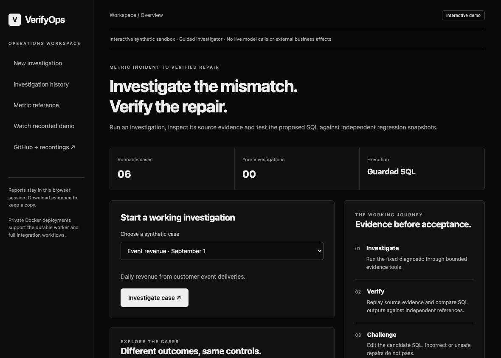
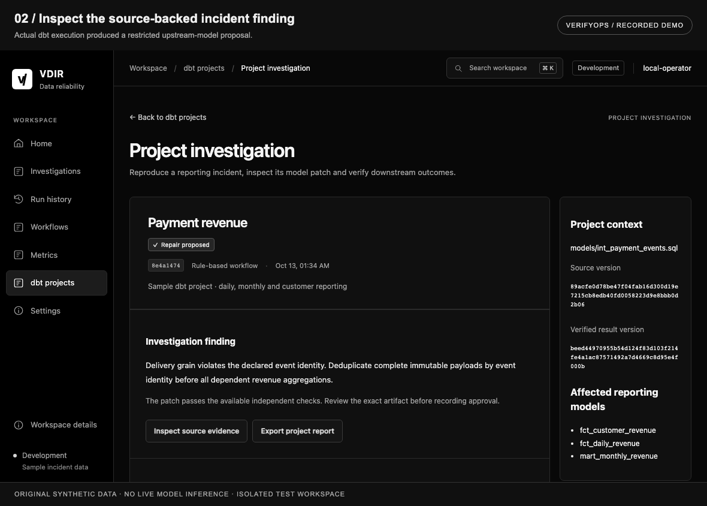
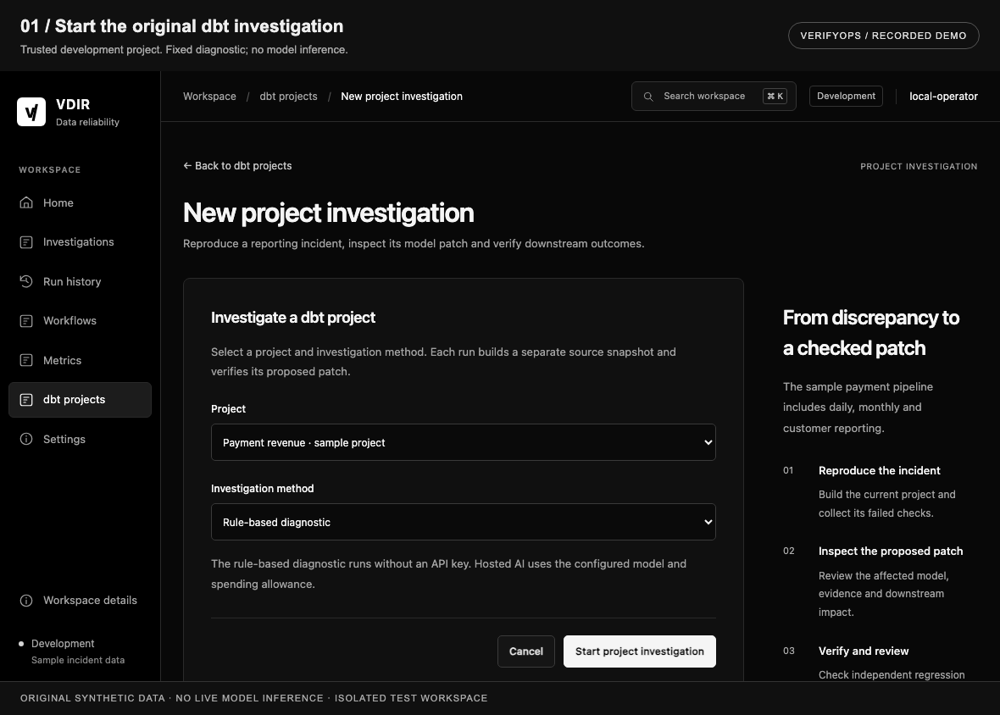
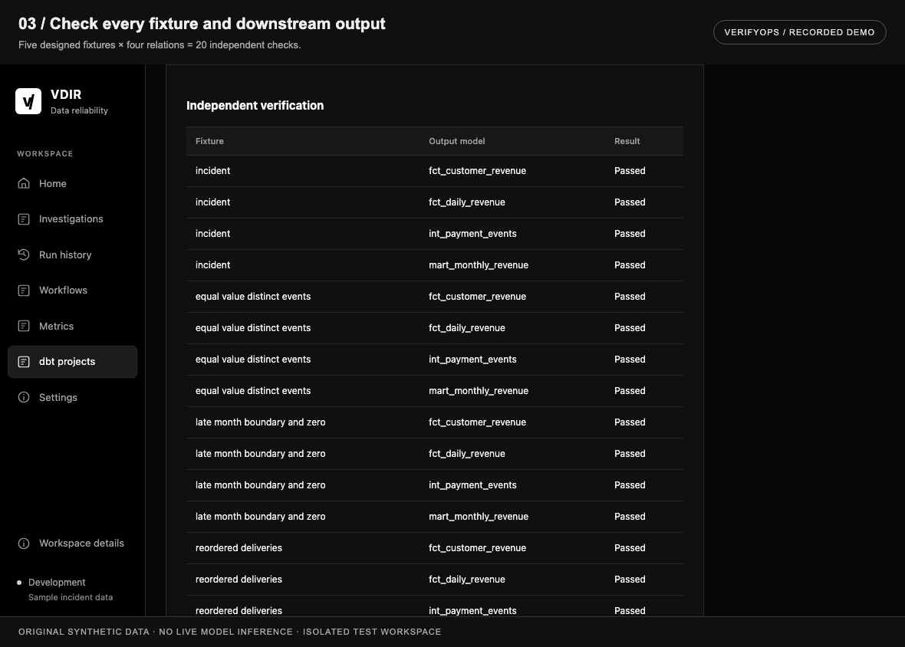
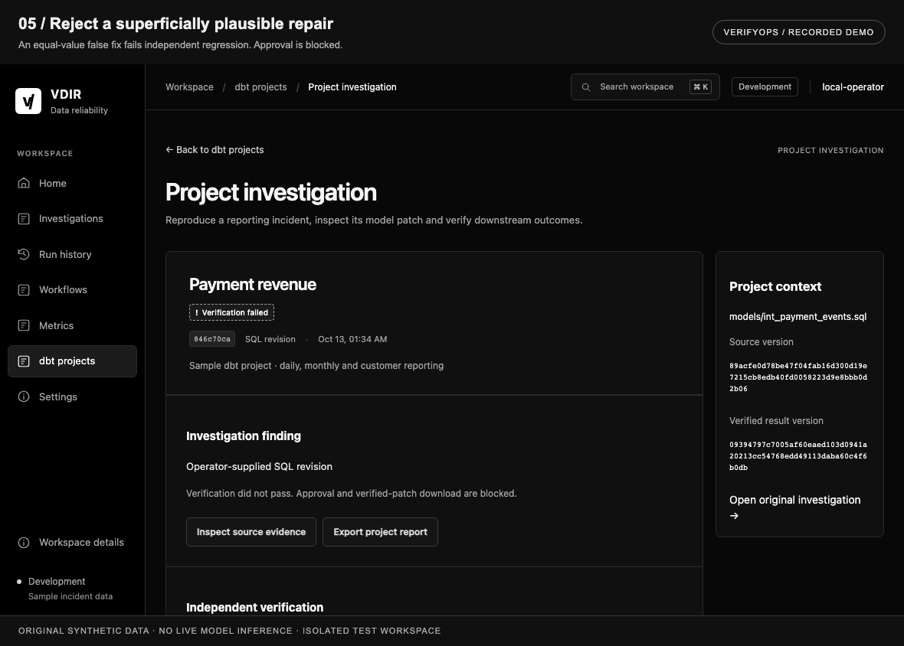

# VerifyOps / recorded demonstration

## New interactive public demonstration

[Run the app](https://verifyops.vercel.app/demo) · [Watch continuous browser capture](https://verifyops.vercel.app/demo/recording) · [Download the WebM](../src/vdir/demo_assets/walkthrough.webm)



Choose an incident → run the original fixed investigator and source-level verifier → inspect SQL/evidence → submit a SQL revision → run regression checks again → accept or reject the exact checked result. The recorded SUM(DISTINCT) false repair fails independent checks and cannot be accepted.

This recording captures actual automated clicks and server calculations on synthetic fixtures. No live-model generation or customer feedback is represented. [Recording/source hashes](demos/interactive-recording.json) · [Architecture and replay limits](20-INTERACTIVE-PUBLIC-DEMO.md). The earlier private-workbench recording below is preserved as separate evidence.

## Earlier private-workbench recording

[Project README](../README.md) · [Engineering case study](CASE-STUDY.md) · [Technical index](README.md)



<details>
<summary><strong>Play the recorded walkthrough</strong></summary>



</details>

## What the recording shows

| Stage | View | Actual behavior |
| --- | --- | --- |
| 01 | Start the project | Trusted original payment pipeline, using the fixed diagnostic. |
| 02 | Inspect the incident | Actual dbt execution identifies the delivery/event-grain problem. |
| 03 | Check the outputs | Five designed fixtures and four output relations yield twenty checks. |
| 04 | Inspect the patch | The restricted intermediate-model SQL diff is bound to the checked result. |
| 05 | Reject the false fix | Equal-value grouping fails regression; approval is disabled. |
| 06 | Review the checked version | An automated synthetic review records the exact original result. |

The GIF contains 6 captured stages at 2.8 seconds each. The header and footer are authored recording annotations outside the unchanged app screenshot. Every application frame comes from actual browser execution in a separate temporary workspace. The monochrome GIF palette preserves the captured frame's grayscale pixel values; no generated/fabricated UI or scores are inserted.

## Static detail views





## Scope and provenance

- Original synthetic development data. The fixed diagnostic exercises the real dbt build/repair/verifier pipeline.
- No live model generation or API spend in this recording. The demonstration does not establish live model diagnosis or general warehouse correctness.
- Approvals are automated synthetic sandbox demonstrations; they are not actual customer/operator feedback.
- No production warehouse write or repository merge. The UI retains the earlier VDIR brand.
- The user's existing local application histories were preserved. Generated databases, reports, raw frames and recording manifests remain ignored.

## Reproduce the underlying journey

Follow the [fresh-checkout setup](../README.md#run-locally), then run:

```sh
VDIR_LOAD_DOTENV=0 PYTHONPATH=src .venv/bin/python tests/browser_dbt_smoke.py
```

The original browser integration program starts an isolated server and checks the workflow. Generated output paths are printed by the program. These checks establish integration behavior; live quality needs separately configured, independently graded evaluations.

## Original share artwork

[1280 × 640 PNG](assets/verifyops-share.png) · [Native SVG](assets/verifyops-share.svg)

The card is ready for sharing or manually setting as a repository social preview. This change does not claim that GitHub's social-preview setting was updated. It identifies a development release and records engineering checks without employer logos, affiliation badges or AI accuracy claims.
