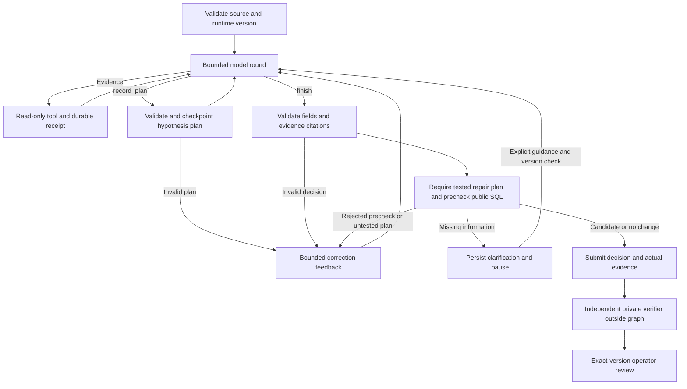

# LangGraph investigator

The owned workflow is `vdir-graph-3`. LangGraph 1.2.14, checkpoint 4.2.0, and the SQLite checkpointer 3.1.1 are pinned. The app selects `langgraph` beside `baseline` and `anthropic`. The fixed diagnostic remains the default. Graph-3 adds a strict findings node, a twelve-identifier public memory index, SQL inspection profiles, hypothesis plans, executed-test requirements, and public SQL prechecks. A checkpoint from an older graph version cannot be continued. Completed results stay readable.

[Findings, workflows, and cancellation](WORKFLOWS.md).

## Purpose and boundary

`agent/investigator/graph.py` implements the `StateGraph`: prepare a bounded model round, invoke the official async SDK, then route to checkpointed evidence, structured planning, or decision validation. A public SQL precheck runs before submit, correct, or interrupt for guidance. The graph reuses the evidence tools, the independent verifier, the review service, and the evaluation runner. `graph.plan`, `graph.precheck`, and `graph.feedback` join the model and tool spans through OpenTelemetry. Pydantic schemas live in `agent/investigator/agent_policy.py` and are exported without evaluator code. The gates follow [LangGraph workflows](https://docs.langchain.com/oss/python/langgraph/workflows-agents).



The graph may nominate SQL and cite evidence. It cannot access private regression sources/reference functions, set verification success, approve a repair or execute production writes. Evidence replay and separate verification remain authoritative. Operator guidance is untrusted context, not new authoritative source data. A changed contract/source requires a new incident version; missing offsets/conflicting source values remain unresolved until their authoritative data exists.

## State and ownership

State contains the evidence, code, and package version, bounded provider messages, the public evidence trace, repeat counters, rounds, token usage, active call time, pending calls and replies, the validated decision, model metadata, structured plan revisions, the correction count, and the activity journal. Plans contain concise falsifiable hypotheses and tests. No provider secrets or evaluator answers are checkpointed. Traces stay inside the tool, row, column, cell, and byte caps.

## Planning and bounded correction

The graph-only `record_plan` tool accepts a bounded objective, one to three hypotheses with unique h1–h3 IDs, concise claim/expected signal and a SQL test, plus unique existing successful evidence IDs. Strict Pydantic models reject coercion, extra fields, overlong values and invalid shapes; separate checks validate citations and unique IDs. A maximum of three revisions is checkpointed. Plans are public proposals and do not certify their claims. A repair must have a plan and cite at least one successful, complete query whose SQL matches a test in its latest plan. Plans can incorporate already observed tests; this is not proof that planning preceded evidence collection. Healthy no-change and clarification outcomes need no repair plan.

Invalid plans/decisions, unsupported SQL execution, incomplete output and output-schema errors produce structured tool feedback. The same investigator may correct them at most **twice total**, within the original **eight model rounds / 24 evidence calls / 12,000 output tokens / counted context / 240 active call seconds**. Planning uses model rounds but creates no source evidence. The counter survives checkpoints, crashes and guidance; no budgets are reset. Invalid provider envelopes/IDs/names, unresolved call receipts and hard resource limits still fail closed. Feedback includes public issues only; private regressions/reference answers are unavailable.

## Public precheck versus independent verification

Candidate and no-change submissions must execute safely, completely and with exact contract output columns on the current public snapshot. An existing successful identical query may be reused; otherwise the controller executes one bounded evidence query, journals its receipt before checkpoint commit and charges it to the same tool/time budget. The actual query evidence ID is included in the submitted decision. Rejected SQL/partial/wrong-shaped outputs cannot finish successfully; an operator clarification submits no SQL.

This checks execution, columns and completeness, **not business correctness**. A query with correct columns and wrong aggregation can pass this stage and fail the independent verifier. Tests explicitly demonstrate that boundary. The private verifier still replays every actual tool call and checks source references/regression snapshots. Operator approval remains an exact-version human action outside the graph.

Completed/paused results expose `agent_workflow` (plan revisions, activity, correction count and public precheck) in JSON exports and the app's **Agent activity** tab. Entries are recorded node events, not fabricated live progress. Manually edited SQL revisions remove inherited workflow/model/graph metadata, so a prior agent assessment is never presented as checking a different SQL version.

`AsyncSqliteSaver` writes `graph-checkpoints.sqlite` between transitions for offline runs. `AsyncPostgresSaver` is used when `VDIR_CHECKPOINT_DATABASE_URL` is set. The separate receipt journal reserves each call before execution and persists the completed result before the graph commit. [Persistence](https://docs.langchain.com/oss/python/langgraph/persistence).

The job service owns admission, leases and review; LangGraph owns investigation transitions. A `needs_information` decision interrupts the graph and is independently checked before the app records a `paused` result. POST `/api/jobs/{id}/resume` accepts the exact `parent_version` and 1–2000 characters of `guidance`, with the existing authentication/origin/body/idempotency controls. A transaction allows one child continuation per parent. The worker clones public evidence and committed SQLite state using database backup, then resumes the child. The parent result/version stays immutable; its audit records the child. Repeated identical submissions reuse the same child, while competing/stale submissions fail.

Restored budgets include consumed rounds, tools/repetitions, reported tokens, counted provider input context and active call time; human waiting does not consume the call-time budget. Recovery reuses completed receipts if a process died before its graph checkpoint. An unresolved receipt blocks replay: a provider may already have completed/billed, so no exactly-once billing guarantee is made. Failed metadata records successful receipt usage and unknown additional billing. Expired app jobs retain the existing interrupted/no-automatic-retry policy; app continuation currently supports paused graphs only. Standalone recovery is explicit and does not claim application lease recovery.

## Run and continue

Enter the private provider key/model in ignored .env. The app enables LangGraph when configured; no key is shown in browser configuration. Example live commands from the project directory (billable):

```sh
PYTHONPATH=backend/src .venv/bin/python -m vdir --investigate artifacts/generated/live-graph-six --investigator langgraph --engine duckdb
PYTHONPATH=backend/src .venv/bin/python -m vdir.evaluation.benchmark --output artifacts/generated/live-graph-benchmark --investigator langgraph --samples 1
```

The app's paused result offers an investigation guidance field and Resume investigation button. Changing source data requires a new incident. Standalone exported CLI runs may be explicitly recovered/continued (these commands return an investigator response; they do not independently grade the continuation):

```sh
PYTHONPATH=backend/src .venv/bin/python -m vdir.cli.graph_resume --workspace artifacts/generated/live-graph-six/case-003/evidence --guidance-file /path/to/guidance.txt
PYTHONPATH=backend/src .venv/bin/python -m vdir.cli.graph_resume --workspace artifacts/generated/standalone-interrupted/evidence --recover
```

Use the app API for app-owned jobs so admission/ownership/audit rules remain enforced. Graph version, installed framework/provider versions, source bytes and exported code are checked on resume. Checkpoint migration is deliberately unsupported; changed versions require a new run.

Version 2 changes the owned graph state, prompt, and runtime fingerprint. Existing version-1 checkpoints are rejected on continuation. Their stored results remain readable. Start a fresh investigation.
