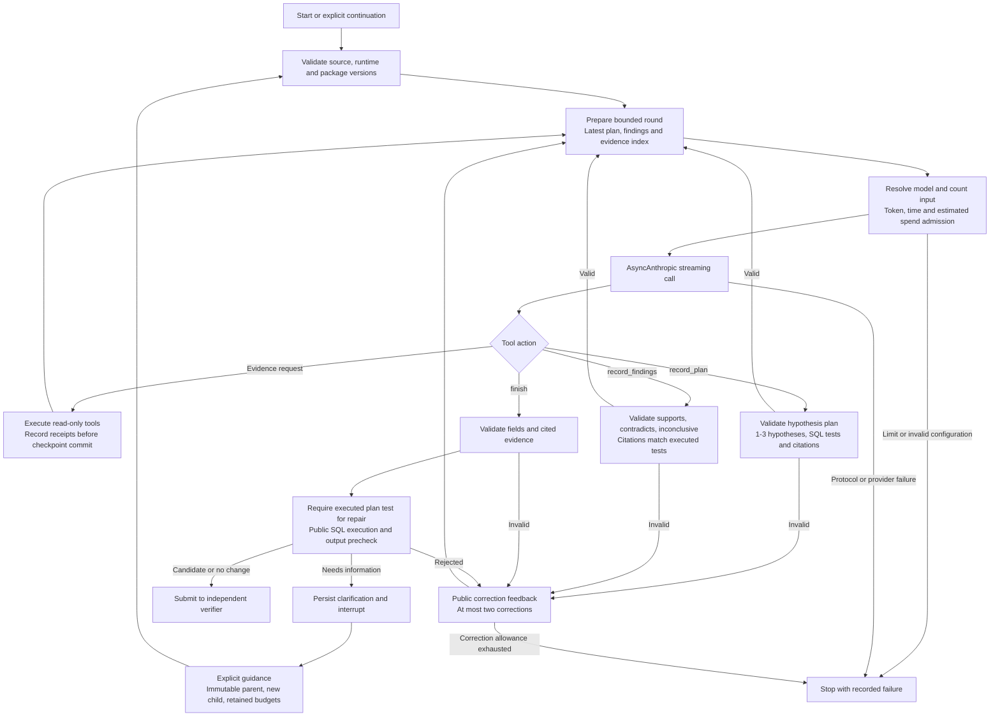
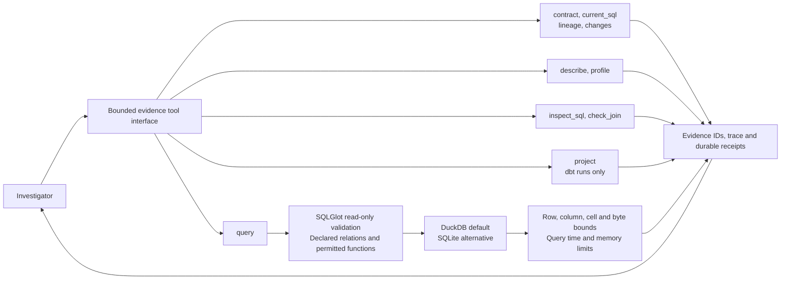

# LangGraph investigator

The owned workflow is `sqlarbiter-graph-3`, built on LangGraph 1.2.14 with `langgraph-checkpoint` 4.3.0 and the SQLite (3.1.1) and PostgreSQL (3.1.3) checkpointers. The app offers three investigators: `baseline` (the fixed diagnostic, and the default), `anthropic` (a hosted tool-use controller) and `langgraph`. Model-backed investigators are selectable only when a provider key and model are configured privately.

`agent/investigator/graph.py` implements the `StateGraph`. Pydantic schemas live in `agent/investigator/agent_policy.py`. The package keeps flat imports so it runs when exported into an isolated workspace, without backend or evaluator code on its import path. The design follows [LangGraph workflows](https://docs.langchain.com/oss/python/langgraph/workflows-agents).

## Authority

The graph may nominate SQL and cite evidence. It cannot read private regression sources or reference functions, set verification success, approve a repair or write to a business system. Evidence replay and the separate verifier stay authoritative. Operator guidance is untrusted context, not new source data: a changed contract or source requires a new incident version, and missing offsets or conflicting source values stay unresolved until authoritative data exists.

## Graph



The nodes are `prepare`, `model`, `evidence`, `plan`, `findings`, `decide`, `review` (public precheck), `feedback` and `clarify`. `graph.plan`, `graph.precheck` and `graph.feedback` spans join the model and tool spans through OpenTelemetry.

State holds the source, code and package version, bounded provider messages, the public evidence trace, repeat counters, rounds, token usage, active call time, pending calls and replies, plan revisions, findings, the correction count, the validated decision and the activity journal. No provider secret or evaluator answer is checkpointed.

## Tools



- `inspect_sql({sql})` parses one permitted read-only statement with SQLGlot and returns source dependencies, join clauses, aggregates, grouping expressions and `DISTINCT` usage. It is static inspection and does not establish semantic correctness.
- `check_join({left_table,left_key,right_table,right_key})` profiles an equality join in DuckDB or SQLite: source rows, distinct non-null keys, duplicate keys, implied inner-join rows, unmatched left rows and null-key counts. It returns no raw records. Composite keys, filters and temporal semantics need separate queries.
- Every tool call consumes the 24-call evidence allowance and creates a receipt and evidence ID that the evaluator replays. Oversized responses are discarded before the error record is stored. SQLite authorization supports empty-column aggregate reads for declared sources and validated CTE names; see [SQLite authorization](https://www.sqlite.org/c3ref/set_authorizer.html).

## Plans, findings and working memory

`record_plan` accepts a bounded objective and one to three hypotheses with unique `h1`–`h3` IDs, each with a claim, expected signal and SQL test, plus existing successful evidence IDs. Strict Pydantic models reject coercion, extra fields and overlong values. At most three revisions are checkpointed. A repair must cite at least one successful, complete query whose SQL matches a test in the latest plan. Plans may incorporate already observed tests, so a plan does not prove that planning preceded evidence collection. No-change and clarification outcomes need no plan.

`record_findings` accepts the current plan revision and one to three hypotheses assessed as `supports`, `contradicts` or `inconclusive`, with summaries of at most 480 characters and one to four evidence IDs. Each ID must refer to a successful, complete `query` whose SQL matches that hypothesis's test. Three revisions of three hypotheses bound the ledger to nine entries. Findings are model interpretations, not certified conclusions.

Before each round the controller appends a public working-memory index to the counted system prompt: the latest plan, its findings and the latest twelve evidence identifiers, methods and completeness flags. Raw rows are not copied into it, and the full transcript and receipts are retained, so this is an index rather than context compaction. The shape follows [Anthropic's context engineering guidance](https://www.anthropic.com/engineering/effective-context-engineering-for-ai-agents).

## Precheck and bounded correction

Candidate and no-change submissions must execute safely and completely with the exact contract output columns on the current public snapshot. An identical successful query may be reused; otherwise the controller runs one bounded query, journals its receipt before the checkpoint commit and charges it to the same budget. The resulting evidence ID is included in the decision.

The precheck establishes execution, columns and completeness, not business correctness: a query with the right columns and wrong aggregation passes here and fails the independent verifier, and tests demonstrate that boundary.

Invalid plans, findings or decisions, unsupported SQL, incomplete output and output-schema errors produce structured feedback. The investigator may correct at most **twice per run**, inside the original budget of **8 model rounds, 24 evidence calls, 12,000 output tokens, counted input context and 240 active call seconds**. The counter survives checkpoints, crashes and guidance, and no budget is reset. Invalid provider envelopes, unresolved receipts and hard limits fail closed. Feedback contains public issues only.

Completed and paused results expose `agent_workflow` (plan revisions, findings, memory index, node activity, corrections and precheck) in JSON exports and the workbench **Agent activity** tab. These are recorded artifacts, not live narration. A manually edited SQL revision drops inherited agent metadata, so an assessment of one SQL version is never shown against another.

## Checkpoints, receipts and continuation

`AsyncSqliteSaver` writes `graph-checkpoints.sqlite` for offline runs; `AsyncPostgresSaver` is used when `SQLARBITER_CHECKPOINT_DATABASE_URL` is set, with one stable thread per job. A separate receipt journal reserves each provider call before execution and persists its result before the graph commit. Recovery reuses completed receipts; an unresolved receipt blocks replay because the provider may already have billed the call. [LangGraph persistence](https://docs.langchain.com/oss/python/langgraph/persistence).

A `needs_information` decision interrupts the graph and is checked independently before the job becomes `paused`. `POST /api/jobs/{id}/resume` accepts the exact `parent_version` and 1–2000 characters of `guidance`, under the normal authentication, origin, body and idempotency controls. One child continuation is allowed per parent. The worker clones public evidence and committed SQLite state with the database backup API, restores consumed rounds, tool calls, tokens, input context and call time, and resumes the child. Human waiting time does not consume the call-time budget. The parent stays immutable and its audit records the child.

Graph version, framework and provider versions, source bytes and exported code are checked on resume, and checkpoints are not migrated: a checkpoint from another graph version requires a new run, while its completed results stay readable. Expired application jobs become `interrupted` and are not retried. dbt clarifications cannot be continued; start a fresh run.

## Spend admission

Hosted and LangGraph execution require a trusted pricing profile and a shared ledger. The defaults are **\$1 per investigation workspace and \$5 per ledger**. These are application allowances, not provider invoice limits. The fixed diagnostic makes no model calls.

Before each generation the controller resolves the model, counts input, enforces token limits and atomically reserves worst-case input and cache cost plus the requested maximum output. Complete streams reconcile reported usage in integer microdollars, rounded up. Invalid, partial or unknown streams keep their reservation, a killed process leaves its reservation consuming the allowance, and usage beyond a reservation is accounted in full and blocks further generation. Model mismatches are recorded as unknown rather than priced at a cheaper rate. Generation retries are disabled.

`SQLARBITER_RUN_BUDGET_USD` and `SQLARBITER_TOTAL_BUDGET_USD` set the allowances. The ledger defaults to `spend.sqlite` in the state directory and is shared by API, workers and CLI; `SQLARBITER_SPEND_LEDGER` overrides it. `SQLARBITER_PRICE_PROFILE` defaults to `backend/data/pricing/claude-sonnet-5-5.json`, which follows the [official pricing](https://platform.claude.com/docs/en/about-claude/pricing). Reservations use the highest configured input or cache rate. Ledger policy is bound at creation, so changing limits or rates cannot reset balances; select a new ledger for a new allowance period. SQLite `BEGIN IMMEDIATE` coordinates processes on one host.

Authenticated `GET /api/spend` reports allowances, the remaining estimate and settled, reserved, unknown and overrun counts, and the Settings page shows them. A graph continuation gets a new workspace allowance while inherited token budgets and the shared ledger still apply.

## Running live

Set the provider key and model in the ignored `.env`. These commands are billable:

```sh
PYTHONPATH=backend/src .venv/bin/python -m sqlarbiter --investigate artifacts/generated/live-graph --investigator langgraph --engine duckdb
PYTHONPATH=backend/src .venv/bin/python -m sqlarbiter.evaluation.benchmark --output artifacts/generated/live-graph-benchmark --investigator langgraph --samples 1
```

Exported standalone runs can be continued or recovered from the CLI. These commands return the investigator response and do not grade the continuation; use the app API for app-owned jobs so admission, ownership and audit rules apply.

```sh
PYTHONPATH=backend/src .venv/bin/python -m sqlarbiter.cli.graph_resume --workspace artifacts/generated/live-graph/case-003/evidence --guidance-file guidance.txt
PYTHONPATH=backend/src .venv/bin/python -m sqlarbiter.cli.graph_resume --workspace artifacts/generated/interrupted/evidence --recover
```

[Overview](OVERVIEW.md) · [Jobs](JOBS.md) · [Decisions](DECISIONS.md)
