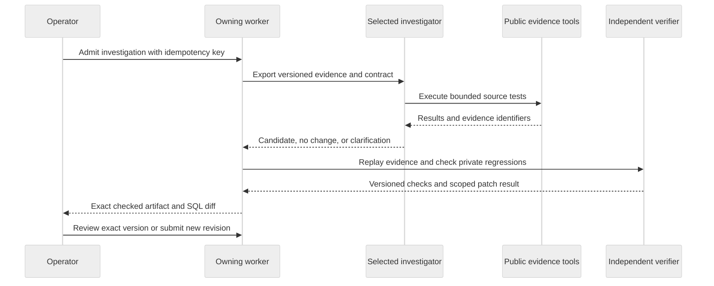

# VerifyOps / engineering case study

**Executing SQL successfully is weaker evidence than showing that the business outputs are correct.**

[Recorded demo](../DEMO.md) · [System map](../assets/diagrams/verifyops-architecture.svg) · [Full flows](SYSTEM-FLOWCHARTS.md) · [Run it](../../README.md#run-locally)

## The original business case

The original payment-revenue seed contains deliveries `d1` and `d2` for the same immutable event `e1`, each carrying 1,200 cents. The defective intermediate preserves delivery-grain rows, so September 30 reports 2,400 cents. A restricted event-identity repair restores 1,200 cents while retaining separate valid events with equal values.

This is original synthetic development data and a trusted five-model dbt project. The recorded demo uses the fixed diagnostic; it is not a live model benchmark or a production warehouse promotion.

## What is technically difficult

A repair can execute, appear reasonable, and pass the original incident while breaking another valid source case. The investigator also needs bounded source tools, persistent receipts, cancellation and versioned results. The application must bind review to what was actually checked rather than an edited or stale patch.

| Responsibility | Owned implementation | Why it matters |
| --- | --- | --- |
| Investigate source evidence | [graph.py](../../agent/investigator/graph.py), [tools.py](../../agent/investigator/tools.py) | Checkpointed transitions, bounded SQL tools, hypotheses and executed/cited findings. |
| Bound model execution | [model.py](../../agent/investigator/model.py), [spending.py](../../backend/src/vdir/platform/spending.py) | Typed async model transport, call receipts, token/time limits and retained estimated commitments. |
| Check correctness independently | [evaluation.py](../../backend/src/vdir/evaluation/evaluation.py), [reference.py](../../backend/src/vdir/verification/reference.py) | Separate source references and private regressions outside model authority. |
| Execute the real dbt repair | [dbt_workflow.py](../../backend/src/vdir/workflows/dbt_workflow.py), [original project](../../backend/dbt/revenue_incident) | Actual seed/run/test, restricted model patch and fresh builds across designed fixtures. |
| Own durable execution/review | [jobs.py](../../backend/src/vdir/persistence/jobs.py), [worker.py](../../backend/src/vdir/workers/worker.py), [dbt_service.py](../../backend/src/vdir/workflows/dbt_service.py) | Claims/leases, cancellation, guarded publication and source/model/patch/report integrity. |

## Authority boundaries

The selected investigator can be the fixed diagnostic, hosted controller or owned LangGraph agent. Source inspection, independent checking and operator review retain distinct authority. Review records a decision; production writes and repository merges are not connected.

## A repair that must fail

Grouping rows by customer, timestamp, status and amount can hide the duplicate in the original incident. It also collapses genuinely distinct equal-value events. The recorded walkthrough submits that false fix and shows independent verification rejecting it; approval and verified-patch download are blocked.

The passing repair is checked with actual dbt builds over five designed fixtures and four output relations, yielding 20 model checks. The original incident is one fixture, not the entire correctness argument. [Patch restrictions and fixture design](SPENDING-AND-DBT.md).

## Failure behavior worth inspecting

| Failure | Expected behavior | Evidence |
| --- | --- | --- |
| Plausible equal-value deduplication | Reject through independent regression rather than approve based on the original metric. | [Recorded demo](../DEMO.md), [real dbt integration](../../backend/tests/workflows/test_dbt_integration.py) |
| Edited SQL after verification | Disable old approval and create a separately checked revision. | [dbt browser journey](../../backend/tests/e2e/browser_dbt_smoke.py) |
| Failed/tampered patch | Block approval and verified download. | [dbt browser workflow](DBT-WORKFLOW.md), [service implementation](../../backend/src/vdir/workflows/dbt_service.py) |
| Missing authoritative source facts | Request clarification; do not invent a timezone or conflicting event payload. | [Development cases](../../backend/src/vdir/domain/cases.py), [agent flow](AGENT-ORCHESTRATION.md) |
| Cancellation or lost ownership | Stop controlled work and fence result publication. | [Worker](../../backend/src/vdir/workers/worker.py), [job store](../../backend/src/vdir/persistence/jobs.py) |
| Interrupted model generation | Retain uncertain receipts; explicit compatible recovery only. | [Model/recovery boundaries](AGENT-ORCHESTRATION.md), [transport](../../agent/investigator/model.py) |

## What the evidence establishes

Recorded CI evidence includes 133 unit passes plus one optional integration skip per workbench suite, 96 native browser checks, 120 container checks including 24 dbt checks, a dedicated real dbt job, a runtime build and 38 known fixed-diagnostic cases. Exact source/run references and reproduction are in the [recorded verification progress](../project/PROGRESS.md) and [contribution guide](../../.github/CONTRIBUTING.md).

The new recording shows actual app/dbt execution, 20 output checks, false-fix rejection and automated exact-version sandbox review. It does not establish live AI accuracy, unseen generalization, real operator validation or monitored cloud operation.

## Design choices and current limits

- **Separate investigation and correctness.** Public plans/findings are checked against executed evidence; private references and regressions never become model feedback.
- **Restrict the patch surface.** Only the trusted project's declared intermediate model is editable; arbitrary customer repositories/macros need new isolation and connector work.
- **Keep reviews version-bound.** Changed SQL creates a new verification job; source/model/patch/report versions protect approval and export integrity.
- **Retain uncertain execution.** Local leases, checkpoints and receipts preserve ownership and replay boundaries. They do not establish distributed scalability or per-investigation OS isolation.
- **Measure the actual scope.** Designed fixtures and known fixed cases are regression/integration evidence; live comparisons and broader untouched cases remain release gates.
- **Resolve packaging conflicts explicitly.** dbt tooling uses a separate environment and is executed in container/dedicated CI, rather than assumed compatible with the application lock.

Next gates are controlled live evaluation, representative warehouse/dbt inputs, individual identity, durable shared state, isolated execution and a measured cloud/operator pilot. See [release plan](../project/PLAN.md), [decisions](../DECISIONS.md) and [technical index](../README.md).
