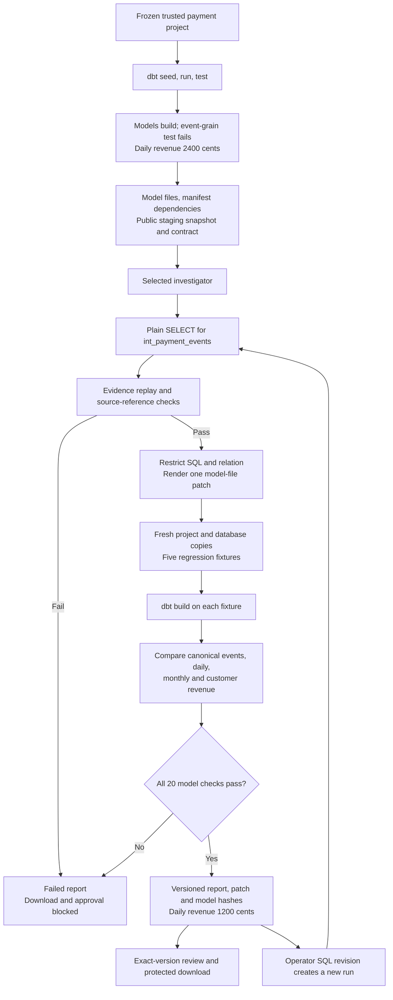

# dbt repair workflow

A real dbt project, `backend/dbt/revenue_incident`, is the repair target. The workflow builds it, lets the selected investigator propose a fix for one upstream model, renders a restricted patch and accepts it only if five independent regression fixtures pass.

## Incident

Five models: the `payment_deliveries` seed feeds `stg_payment_deliveries`, then `int_payment_events`, `fct_daily_revenue` and `mart_monthly_revenue`; `fct_customer_revenue` also depends on `int_payment_events`.

Identity is `event_id`, not `delivery_id`, amount or `received_at`, and immutable events may be redelivered. Revenue uses the explicit UTC `occurred_at`, even for deliveries received the next month. Reporting includes completed payments; canonical events retain pending ones. The defective intermediate model emits delivery grain, so September 30 revenue is 2400 cents instead of 1200. Every model builds and a declared dbt grain test fails.

## Pipeline



The runner executes real `dbt seed`, `run` and `test`, reads manifest dependencies and model files, exports only the staging snapshot and public project, and invokes the fixed, hosted or LangGraph investigator. A bounded `project` tool exposes public model and lineage metadata.

Candidates are plain `SELECT` statements for one allowed upstream model, using the SQL allowlist and the declared staging relation. Jinja, arbitrary paths, macros, hooks, mutations and external file functions are rejected; trusted rendering inserts the fixed `ref`. The unified diff is built in fresh project and database copies and checked against five fixtures: the original incident, equal-value distinct events, late month boundaries with zero and pending values, reordered deliveries, and an empty batch. Python references check canonical events, daily and monthly revenue and customer totals, giving 20 model checks. A fix that merges equal-value distinct events passes the original incident, fails regression and produces no verified patch.

Reports bind source, model and diff hashes, affected models, the original dbt failure, per-fixture outputs and an exact report version. These are scoped regression checks for one known project, not a proof of arbitrary SQL semantics.

## Browser workflow

| Route | Behavior |
| --- | --- |
| `/dbt` | Project catalog with tooling readiness, models, fixtures and run history |
| `/dbt/new` | Setup: choose the fixed diagnostic, LangGraph or hosted investigator |
| `/dbt/runs/{id}` | Progress, evidence drawer, reporting impact, 20 model checks, unified diff, SQL revision, review and downloads |

The browser POST queues work and the separate worker executes the build. Progress is written only at real build, investigation and fixture boundaries. Candidate SQL edits disable approval and create a new verification job that uses the fixed diagnostic and verifier without model tokens. Downloads serve the stored, verified patch rather than a local file.

| API | Behavior |
| --- | --- |
| `GET /api/dbt/projects` | Trusted sample metadata, readiness and source version; no executable or private paths |
| `POST /api/dbt/runs` | `project_id` and investigator; Idempotency-Key required; the 16-job limit applies |
| `POST /api/dbt/runs/{id}/revisions` | Exact parent version and plain candidate SQL, creating a checked child |
| `GET /api/dbt/runs/{id}/patch` | Passing results only; re-verifies stored artifact hashes and serves a `.patch` file |

Job state, cancellation, review and report export reuse the `/api/jobs/{id}` routes. For dbt runs the server also checks the signed report and stored patch and model hashes at review and download, so a changed artifact, stale version or failed verification is refused even if a client bypasses disabled buttons. Project versions hash the trusted source assets, implementation, runtime and dependency locks, and a change invalidates queued work. Each dbt subprocess runs in a supervised process group capped at 90 seconds and 2 MB of logs, and a queued dbt run has a 600-second deadline. dbt clarifications cannot be continued.

## Running it

dbt-core 1.12.5, dbt-duckdb 1.11.0 and DuckDB 1.5.6 are pinned in their own environment because dbt's Click requirement conflicts with the application. Container images include it at `/opt/dbt`; `SQLARBITER_DBT_EXECUTABLE` overrides the binary.

```sh
python3.12 -m venv .venv-dbt
.venv-dbt/bin/python -m pip install -r backend/requirements/dbt.txt
PYTHONPATH=backend/src .venv/bin/python -m sqlarbiter.workflows.dbt_workflow --output artifacts/generated/dbt-run
PYTHONPATH=backend/src .venv/bin/python -m sqlarbiter.workflows.dbt_workflow --review-report artifacts/generated/dbt-run/report.json --expected-version REPORT_VERSION --action approved --note "Reviewed contract and checks"
SQLARBITER_RUN_DBT_TESTS=1 SQLARBITER_LOAD_DOTENV=0 PYTHONPATH=backend/src .venv/bin/python -m unittest discover -s backend/tests -p test_dbt_integration.py -v
SQLARBITER_LOAD_DOTENV=0 PYTHONPATH=backend/src .venv/bin/python backend/tests/e2e/browser_dbt_smoke.py
```

Approval requires passing verification and matching report and diff hashes, and `review.json` is immutable. The browser journey builds the project, downloads, revises, reviews and cancels a run without publishing a result. CI runs it in the dedicated `dbt` job and inside the container suite.

[Overview](OVERVIEW.md) · [Jobs](JOBS.md)
