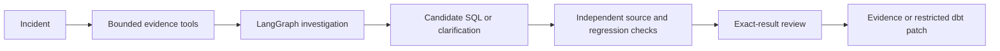

# End-to-end flow

Six original synthetic incidents. Run the fixed diagnostic, inspect source evidence, edit SQL, rerun independent regressions and review the exact checked result. Incorrect repairs cannot be accepted. No production warehouse writes or repository merges occur.

Private agent/runtime:

[Frontend/backend ownership](../development/LAYOUT.md) · [Agent behavior](AGENT-ORCHESTRATION.md) · [Public per-request replay boundary](../operations/PUBLIC-SANDBOX.md).
