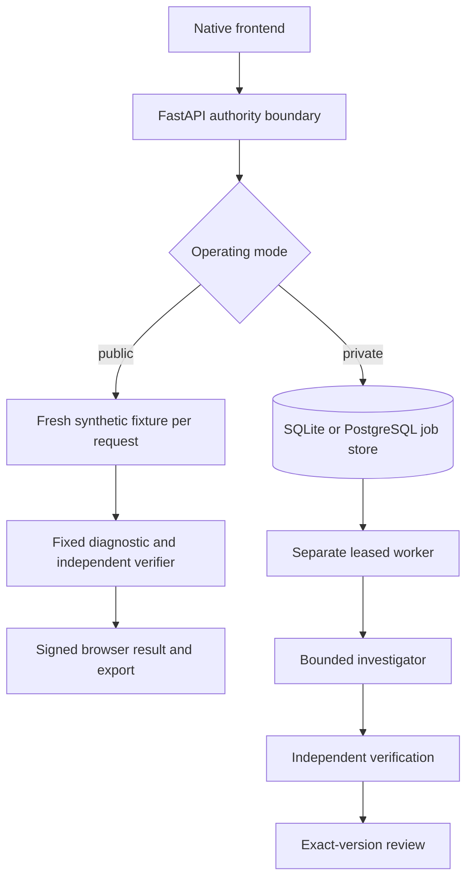
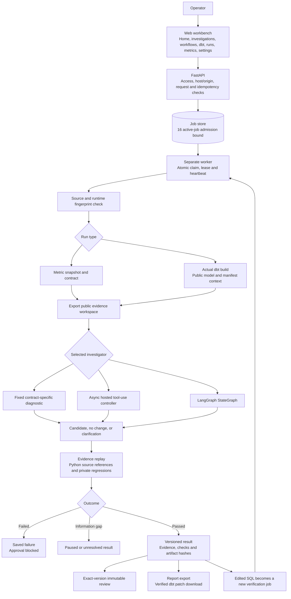

# Architecture overview

SQLArbiter has two operating modes that share the investigator, the evidence tools and the independent verifier.

- **Private runtime.** FastAPI admits work into a persistent job store. A separate leased worker exports an evidence workspace, runs the selected investigator (fixed diagnostic, hosted model or LangGraph), verifies the result independently and publishes a versioned report for exact-version review.
- **Public sandbox.** The Vercel deployment rebuilds an original synthetic fixture on every request, runs the fixed diagnostic and the same verifier, and returns a signed browser-scoped result. It has no queue, no model key and no shared history.

## Application and authority boundaries

- The API admits work; it never runs a model investigation inside the HTTP request.
- The worker owns execution and result publication. Cancellation or lost lease ownership prevents publication.
- The investigator sees only the exported public workspace, never private regression snapshots or reference answers.
- Verification compares outputs with independent references instead of trusting the model's own assertion.
- Review records approval or rejection of one exact result version. It does not apply SQL to a warehouse or merge a repository.

## Data and fixtures

All records are original synthetic fixtures defined in `backend/src/sqlarbiter/domain/`.

- **Retail revenue.** Orders keyed by `order_id`, items by `item_id`, product versions by `product_id` and `version`. Revenue is completed-order item amounts in integer cents. The latest product version inside the snapshot supplies the category; pending and canceled orders do not qualify.
- **Event deliveries.** `delivery_id` identifies a transmission and `event_id` the business event. Equal amount, customer and time do not imply a duplicate event. Conflicting payloads for one `event_id` require authoritative resolution, and UTC counts require explicit minute offsets.
- **Six scenarios** cover three retail snapshots, two event-delivery batches, incomplete and explicit-offset event sources, a healthy retail control and conflicting payloads for one event.

For each run the current snapshot is exported as `source.duckdb` or `source.sqlite`, with `incident.json` and `schema.json`. Regression sources stay with the evaluator. Null and distinct profiling uses exact aggregates under execution budgets, schema metadata is paginated in 50-column pages, and external-file SQL functions and network access are refused.

## Cross-cutting concerns

| Concern | Implementation |
| --- | --- |
| Job lifecycle | SQLite locally, PostgreSQL when configured. Atomic claims, renewable leases, heartbeats and owner-fenced publication. [Jobs](JOBS.md) |
| Agent state | LangGraph checkpoints plus a separate call-receipt journal. Unresolved receipts block automatic replay. [Agent](AGENT.md) |
| Model spending | Shared estimated spend ledger: reserve before generation, settle reported usage, retain unknown reservations. Generation retries are disabled. [Agent](AGENT.md#spend-admission) |
| Cancellation | Supervised subprocess groups are stopped and reaped. Already-sent provider requests can still be billed. [Jobs](JOBS.md#cancellation-and-process-ownership) |
| dbt repair | Restricted single-model patch, five regression fixtures, four output relations. [dbt](DBT.md) |
| Observability | OpenTelemetry spans through jobs, model rounds, tools and verification; JSONL locally or OTLP to Phoenix. |
| Evaluation | Frozen 38-case regression corpus and an eight-case safety suite. [Evaluation](../evaluation/README.md) |
| Delivery | Required `tests`, `container` and `dbt` CI jobs. [Deployment](../operations/DEPLOYMENT.md) |

[Decisions](DECISIONS.md) · [Layout](../development/LAYOUT.md)
