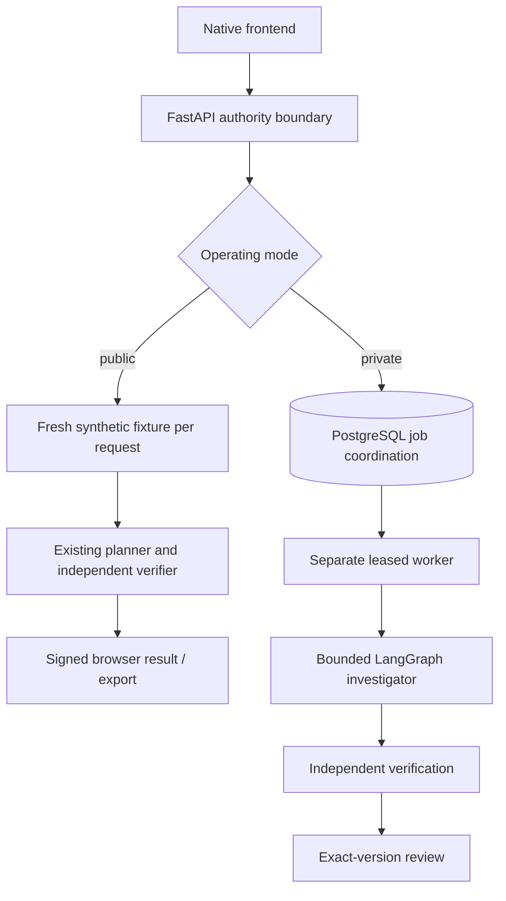

# VerifyOps architecture

## Implemented private runtime

A checkpointed LangGraph investigator uses bounded evidence tools and public corrective feedback. Independent SQL verification and a real dbt workflow check restricted patches across five fixtures and four output relations. PostgreSQL coordinates separate workers and optional graph checkpoints; workspace files still require shared same-node storage.

## Implemented public sandbox

Six original synthetic incidents. Run the fixed diagnostic, inspect source evidence, edit SQL, rerun independent regressions and review the exact checked result. Incorrect repairs cannot be accepted. No production warehouse writes or repository merges occur.

Public state is browser-local and signed where review/action scope requires it. Request stages rebuild original fixtures, not durable business effects. The private persistent worker, live SDK controller and broader browser/dbt integration are separate operating paths.

The model cannot approve its own proposal or bypass typed scope, SQL policy, or independent verification. Durable business-state and workspace files stay on the same node as the worker.

[Agent details](AGENT-ORCHESTRATION.md) · [Current layout](../development/LAYOUT.md).
