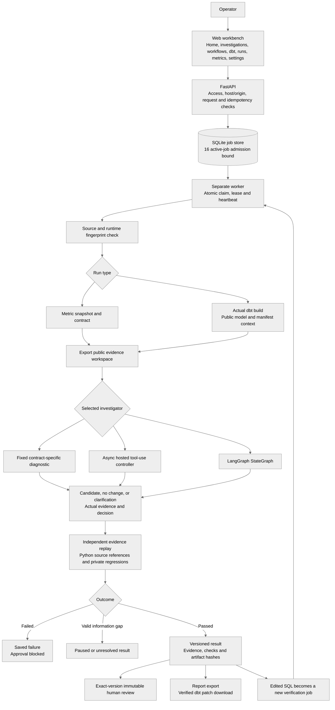
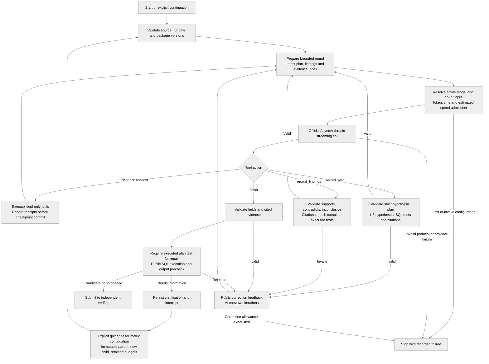
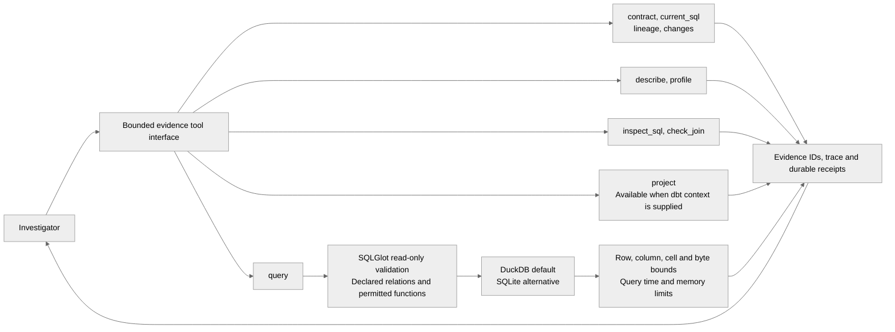
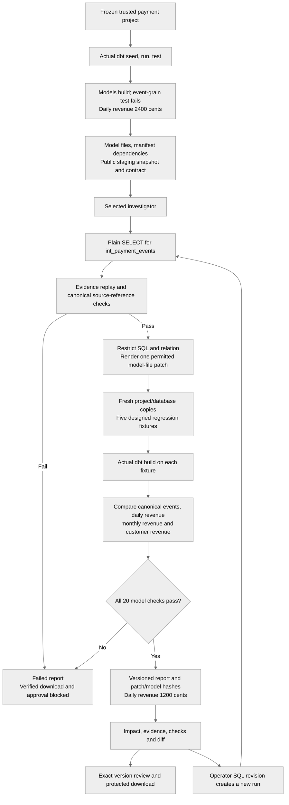

# VerifyOps system flowcharts

Current implementation, October 12, 2026. This is the visual reference for the [README](../../README.md). Live model quality and cloud deployment remain pending. Framework integration and scripted-provider tests do not establish AI accuracy.

## Application and authority boundaries

- The API admits work; it does not perform a long model investigation in the HTTP request.
- The worker owns execution and result publication. Cancellation or lost ownership prevents publication.
- The investigator sees exported public evidence, not private regression data or reference answers.
- Verification compares outputs with independent references, rather than accepting the model's own assertion.
- Review records approval/rejection of the exact result. Production SQL application and repository merge are not implemented.

## LangGraph AI layers

The graph has distinct `prepare`, `model`, `evidence`, `plan`, `findings`, `decide`, `review` (public precheck), `feedback`, and `clarify` nodes. Planning/findings validate public artifacts, not hidden chain-of-thought. Recorded findings are interpretations, not certified conclusions. Planning may incorporate already executed tests; a recorded plan does not prove the model planned before gathering evidence.

Working memory indexes the latest 12 evidence records plus the current plan/findings. The original transcript remains retained. Public prechecks check execution, columns, and completeness; they do not establish semantic correctness. dbt clarification continuation is not currently supported; start a fresh controlled run.

## Tool execution layer

Static SQL inspection and equality-join profiles are diagnostics. They do not cover every join predicate or establish metric correctness. `record_plan`, `record_findings`, and `finish` are separate graph controls. Source values and operator guidance do not override the authoritative contract.

## dbt incident-to-patch pipeline

The project accepts one trusted original sample, not arbitrary repository uploads. Fixtures cover the original incident, equal-value distinct events, late month boundaries/zero/pending values, reordered deliveries, and an empty batch. These are designed regressions, not unseen model evaluation or universal semantic proof.

## Cross-cutting operation

| Layer | Ownership and persistence |
| --- | --- |
| Job lifecycle | SQLite jobs, events, workflows and reviews; atomic claims, renewable leases, heartbeats, owner-fenced progress/publication. |
| Agent state | SQLite LangGraph checkpoints plus a separate call-receipt journal. Unresolved receipts block automatic replay. |
| Model spending | Shared estimated spend ledger: reserve before generation; settle complete reported usage; retain unknown reservations. Real generation retries are disabled. |
| Cancellation | Supervised subprocess groups stop and reap work. Already-sent provider requests can still be billed. |
| Observability | OTel spans propagate through jobs, model calls, tools and verification; JSONL locally or optional OTLP/Phoenix. |
| Evaluation | Known 38-case synthetic corpus and repeated-attempt reporting; scripted integration checks remain separate from live quality. |
| Delivery | Actual native, container and dbt GitHub Actions jobs; archived reports; no API key required for CI. |

SQLite is single-host state. Individual identity, PostgreSQL/distributed recovery, OS-isolated execution, broader held-out/safety tests, actual user feedback and monitored cloud hosting remain pending. See [operational limits](../../README.md#operational-controls), [graph design](AGENT-ORCHESTRATION.md), [dbt workflow](DBT-WORKFLOW.md), and [spend accounting](SPENDING-AND-DBT.md).
