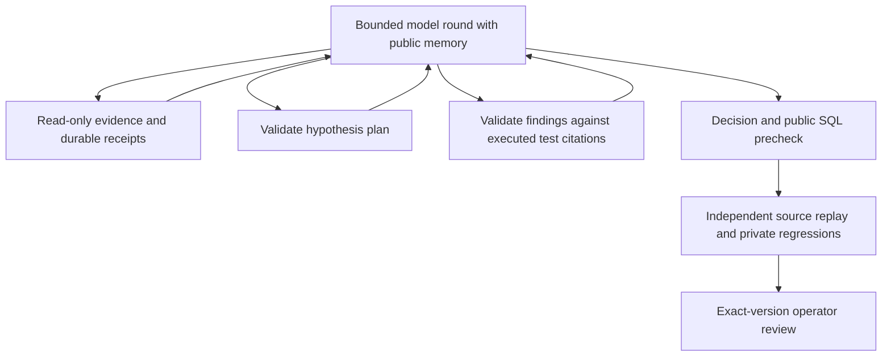

# Findings, multi-metric workflows and cancellation

[Application pages](APPLICATION-PAGES.md) provide investigation and workflow setup, separate workflow collection and detail, metrics, settings, and direct section links. Cancellation and evidence inspection stay in contextual dialogs.

The owned workflow is `vdir-graph-3`: source-cited findings, public working memory, two analytical diagnostics, atomic multi-metric admission, and supervised cancellation.

## Business workflow

An operator can group one to six distinct development metrics into a named workflow. Each metric receives its own investigation, source/runtime version, independent verification and review record. The workflow shows original member outcomes, resolved/attention/cancelled counts and links to each full record. Operators can stop remaining work without deleting finished results. This makes a bounded revenue/event review operationally manageable while preserving each metric's correctness boundary.

These are one-off checks of the existing original synthetic scenarios. They do not ingest customer data, schedule recurring paid calls, modify a warehouse or promote a repair. Graph and hosted methods become selectable only with private configuration; the fixed diagnostic method remains the default. Choosing hosted methods performs a separate potentially billable investigation per selected metric, under each investigation's existing budget.

## Graph-3 findings and working memory

The graph now routes `record_findings` to a dedicated validation/checkpoint node. Strict Pydantic fields accept the current integer plan revision and one to three distinct declared hypotheses, with `supports`, `contradicts` or `inconclusive` assessments, summaries of at most 480 characters and one to four unique evidence IDs. Each ID must refer to a successful, complete public `query` whose SQL exactly matches that hypothesis's test. Unknown, stale, duplicate, partial or unrelated citations fail validation and use the existing shared two-correction allowance.

Findings are model interpretations, not certified conclusions. Replacing a finding updates the current revision/hypothesis entry; prior plan revisions remain present. Three plan revisions with three hypotheses bound the ledger to nine entries. Source/runtime fingerprints bind checkpoints to this run. Old graph-2 checkpoints cannot be continued after the version change; their saved completed results remain readable. Manual candidate revisions still discard inherited agent assessments.

Before each model round, the controller builds public working memory from the latest plan, its findings and the latest twelve evidence identifiers/methods/completeness flags. It appends this memory to the graph system prompt, and the official SDK counts and sends that same prompt. Raw result rows are not copied into this index. Original transcripts/receipts and resource limits remain intact: this is **not context compaction or a demonstrated token reduction**. Neither memory nor operator guidance overrides the authoritative contract or the independent evaluator. The memory index follows the shape described in [Anthropic's context engineering guidance](https://www.anthropic.com/engineering/effective-context-engineering-for-ai-agents).

The app's Agent activity tab renders findings, evidence IDs, the memory index, plan tests, recorded node transitions and public precheck. These are recorded artifacts, not invented real-time agent narration. Findings survive a fresh controller's clarification continuation with unchanged evidence and retained round budgets, verified by an explicit test.

## Analytical tools

`inspect_sql({sql})` parses the permitted single read-only statement with SQLGlot and returns declared source dependencies, join clauses, aggregate names, grouping expressions and DISTINCT usage. This is static inspection: it neither compiles the statement against the database nor establishes semantic correctness.

`check_join({left_table,left_key,right_table,right_key})` validates declared tables/columns and performs a bounded aggregate equality-join profile in DuckDB or SQLite. It measures source rows, distinct non-null keys, duplicate keys, implied inner-join rows, unmatched left non-null rows and null-key counts. It does not return raw records. Null keys do not match. Composite keys, filters, temporal semantics and actual metric correctness need separate queries/checks. Existing read-only function/table restrictions and execution/resource budgets apply; expensive aggregates can be rejected.

Both tools consume the same 24-evidence-call allowance and create receipts/evidence IDs replayed by the trusted evaluator. Replaying valid diagnostics does not make a wrong repair pass. Oversized tool responses now discard the rejected result body before storing/sending the error record. Empty source tables are supported in the DuckDB materializer. SQLite authorization narrowly supports empty-column aggregate reads for declared sources/validated CTE names, retaining the single-query/table/function guards; see [SQLite authorization semantics](https://www.sqlite.org/c3ref/set_authorizer.html).

## Atomic workflow admission

POST `/api/workflows` accepts a bounded name, one to six unique case IDs, a configured investigator and an analytical engine. An idempotency key and request digest identify the entire operation. Under one SQLite `BEGIN IMMEDIATE` transaction, admission checks the total sixteen active-run limit and creates all member jobs, ordered membership and audit entries, or none. Repeating an identical request reuses the same workflow; changing it under the same key conflicts. Case versions are captured before admission and rechecked during execution.

GET `/api/workflows` returns the latest twenty groups; GET `/api/workflows/{id}` retrieves a specific group. Summaries project existing result fields without hydrating full evidence in Python. Member order is the requested order; the queue's ordinary creation-time/ID ordering may execute members in a different order.

`resolved` counts only completed candidate/no-change decisions that passed available independent checks. `attention` includes failed/interrupted/paused work and completed unresolved or rejected outcomes. Active members take status precedence; otherwise attention remains visible. A paused graph can therefore show less than 100% terminal progress with a needs-attention status. Original member runs are immutable: later clarifications or SQL revisions create separate child runs and do not replace the original group totals. Review approval is not resolution or production application.

## Cancellation and process ownership

POST `/api/jobs/{id}/cancel` and POST `/api/workflows/{id}/cancel` use existing shared access, origin, JSON/body limits and server-side ownership rules. A bounded reason is saved and rendered as text in the audit drawer. Workflow cancellation affects only queued/running members and preserves completed/paused results.

| Before | Action | After |
| --- | --- | --- |
| queued | Operator cancels | cancelled immediately; never claimed |
| running | Operator cancels | cancelling; owner stops local execution |
| cancelling | Same owner acknowledges | cancelled; result publication forbidden |
| running | Worker shuts down | interrupted; no automatic replay |
| cancelling | Worker lease expires | cancelled; no automatic replay |
| completed/paused | Single-run cancellation | conflict; saved result preserved |

The worker supervises investigator `Popen` processes in their own POSIX process groups. It polls cancellation/ownership/shutdown and elapsed time about every 200 ms, sends TERM and escalates to KILL if needed, reaps the process and checks ownership again before result publication. Output/error streams go to temporary files and are checked against a two-million-byte threshold; polling can allow transient overshoot, so this is not an OS disk quota. Existing 30-second fixed/270-second hosted subprocess deadlines remain. Private grading remains in the trusted worker with bounded SQL operations; cancellation can wait for an in-flight bounded grading operation, but publication is fenced.

Heartbeats keep a cancelling lease alive while its owner shuts down. Racing cancellation and result publication serialize through the same database ownership/status checks; a stale or cancelled owner cannot publish a result. Already sent provider requests may still complete or be billed. Cancellation is not a refund or exactly-once provider guarantee. Local checkpoint files are not deleted, but this milestone does not add application recovery of interrupted/cancelled runs; create a new run, or use the existing explicit standalone recovery policy where valid.

## UI and verification

New routes `/workflows` and `/workflows/{id}` support reload, browser navigation and investigation-to-workflow back links. The workflow setup and cancellation overlays use native dialogs with focus return/Escape behavior; draft fields survive polling. Missing groups show an explicit unavailable/retry state. All content uses text nodes. The home page links into workflows; run context offers cancellation only for applicable states. Black/white/neutral gray styling and responsive navigation are preserved.

Tests cover concurrent idempotent admission and capacity rollback, cancellation before and after claim and before publication, expired ownership, shutdown, child termination, and output overflow. Browser checks exercise grouped verification, scripted graph findings, cancellation, deep links, and 320–1440-pixel layouts.

The default local store is SQLite. PostgreSQL coordinates replicated API and worker processes. [Runtime](../operations/PRODUCTION-FOUNDATION.md).
