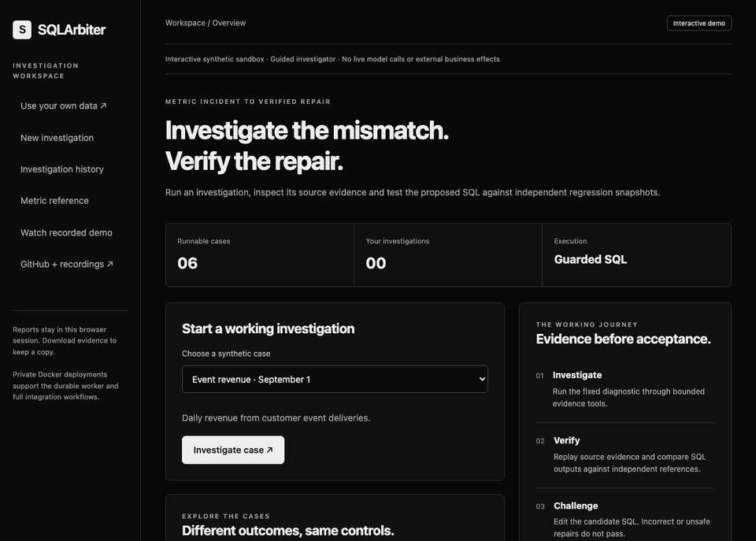

# Recorded demos

Both recordings are continuous Playwright captures of the real application driven by automated interactions on original synthetic data. Neither involves a model call.

## Interactive sandbox

[Continuous WebM](../../frontend/apps/demo/assets/media/walkthrough.webm) · [Manifest](interactive-recording.json)



| Frame | Stage |
| --- | --- |
| 1 | Choose a synthetic incident |
| 2 | Checked proposal |
| 3 | Executed source evidence |
| 4 | False `SUM(DISTINCT)` repair blocked |
| 5 | Independent regression checks |
| 6 | Reviewed result |

## Product workspace

[Continuous WebM](../../frontend/apps/uploads/walkthrough.webm) · [Manifest](uploads-recording.json)

The product recording covers the landing page, empty workspace, source preview, contract review, independent result, quality and SQL evidence, consented save and saved history.

## Provenance

Each manifest stores the SHA-256 of every frame, the video and every source file at capture time. `scripts/checks/check_repository.py` recomputes the source and media hashes in CI and fails if any tracked source differs from the recorded one, so a recording always corresponds to the committed code.

```sh
python scripts/demos/public_demo_browser.py --record --publish-assets
python scripts/demos/product_browser.py --record
```
