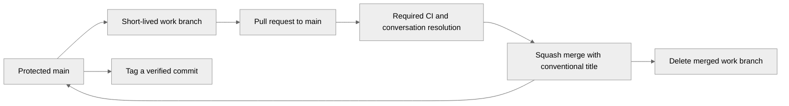

# Branches, pull requests and releases

## Branch model

`main` is the default, stable integration branch. Stable means its required engineering checks pass. All changes reach `main` through a pull request.

| Branch | Purpose | Lifetime |
| --- | --- | --- |
| `main` | Verified shared history and release source | Permanent; protected |
| `feat/<short-description>` | One product, agent or infrastructure capability | Delete after the PR merges |
| `fix/<short-description>` | One reproducible defect and its correction | Delete after the PR merges |
| `docs/<short-description>` | Technical documentation or presentation | Delete after the PR merges |
| `chore/<short-description>` | Dependencies, CI, tooling or repository maintenance | Delete after the PR merges |
| `hotfix/<short-description>` | Urgent correction from current `main` | Same CI and PR gates; delete after merge |

Work branches are short-lived and cut directly from `main`. A release branch is created only when a supported release needs independent maintenance.



## Protected main

The GitHub policy for this repository is:

- Pull request required for every change, including repository administrators.
- All named CI checks below required from GitHub Actions; the branch must be up to date with `main` before merge.
- Unresolved review conversations block merging; stale approvals are dismissed after new changes.
- Linear history, squash-only PR merges, and automatic deletion of merged remote branches.
- Force pushes and deletion of `main` blocked; administrators are included.

Required check names (preserve these names when editing CI):

- `tests`
- `container`
- `dbt`

Settings live in GitHub and are verified through its API; this Markdown file is the documented policy, not an executable protection rule. Check the branch settings if GitHub configuration changes.

## A normal change

From a clean checkout:

```sh
git switch main
git pull --ff-only origin main
git switch -c feat/short-description
# Make and verify one focused change.
# Replace this example path with the specific file you changed.
git add path/to/changed-file
git commit -m "feat(scope): describe the resulting behavior"
git push -u origin feat/short-description
gh pr create --base main --head feat/short-description --title "feat(scope): describe the resulting behavior" --body-file /path/to/pr-body.md
```

The PR body should explain the problem, resulting behavior, commands actually run, test scope and any changes to model/action authority. Keep credentials, private data and generated runtime out of the branch. Use `git fetch origin` and merge `origin/main` into the work branch if it falls behind; do not rewrite published work just to update the base.

Once the required checks pass and conversations are resolved, use GitHub's squash merge. The PR title becomes the final conventional commit title. Optional auto-merge waits for these same requirements; it does not bypass them.

After merging, switch back to `main`, pull with `--ff-only`, and prune obsolete remote tracking refs. GitHub deletes the merged remote branch automatically. Delete the local work branch only after confirming its changes reached `main`; squash merges may require an explicit local branch deletion because the original feature commit is not an ancestor of the squash commit.

## Commit and pull-request titles

Use `feat(scope): ...`, `fix(scope): ...`, `docs(scope): ...`, `refactor(scope): ...`, `test(scope): ...` or `chore(scope): ...`. Keep each PR focused on one reviewable outcome.

## CI and releases

[checks.yml](../../.github/workflows/checks.yml) runs on pull requests targeting `main` and pushes to `main`. Required jobs always run; path filters do not silently skip a gate. New commits cancel superseded runs for the same PR, while `main` verification is allowed to finish.

Release tags use `vMAJOR.MINOR.PATCH`. Tag the exact verified `main` commit. Release notes link the commit, CI evidence, setup, and migration or recovery changes.

GitHub references: [protected-branch API](https://docs.github.com/en/rest/branches/branch-protection), [squash merge configuration](https://docs.github.com/en/repositories/configuring-branches-and-merges-in-your-repository/configuring-pull-request-merges/configuring-commit-squashing-for-pull-requests).
