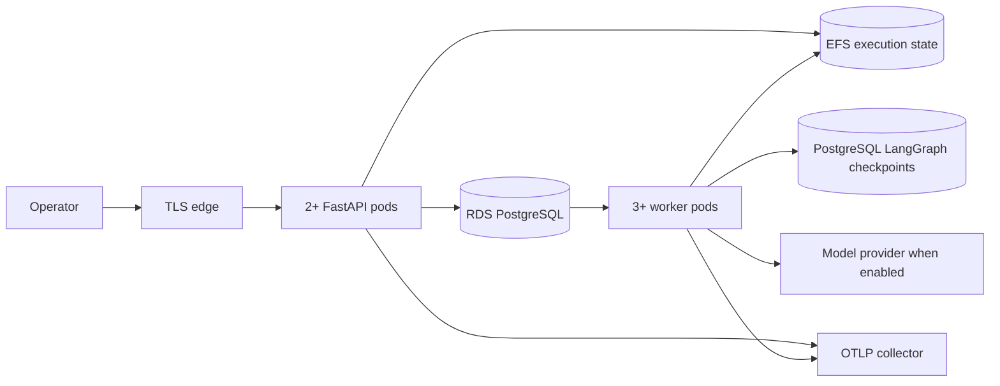

# Deployment

SQLArbiter runs in two shapes: a request-bounded public sandbox on Vercel, and a private persistent runtime with PostgreSQL, separate workers, Compose and Kubernetes. Terraform for AWS is validated in CI.

## Public sandbox

`app.py` is the Vercel entrypoint. It selects public mode, disables provider keys, persistent databases and embedded workers, and enables only the exact `/api/demo/*` and `/api/uploads/*` POST routes; other writes return `405`.

- `backend/src/sqlarbiter/api/public_demo.py` rebuilds an isolated original fixture for every request and calls the same fixed diagnostic and verifier. No client-supplied business state is trusted.
- `demo_security.py` signs expiring source, result and stage envelopes with `SQLARBITER_DEMO_SECRET` (at least 48 characters). Envelopes are bound to an HttpOnly, SameSite=Strict anonymous cookie, so tampering, changed versions and cross-browser reuse are rejected.
- History lives in the browser's `sessionStorage`, and exported JSON omits the envelope. There is no shared public history or durable review ledger. A signed branch can be replayed or forked until it expires, and each replay starts from a fresh fixture.
- Each instance runs at most two investigations concurrently with a 25-second execution allowance. These are per-instance controls, not a distributed rate limiter.
- `.vercelignore` and function exclusions keep deployment tooling and infrastructure state out of the bundle. The isolated `-I` worker receives only installed third-party dependency roots on its import path, never evaluator code.

The workflow: choose an incident, run the fixed investigator and verifier, inspect SQL and evidence, submit a SQL revision, rerun the regressions, and accept or reject the exact checked result. A `SUM(DISTINCT)` false repair fails independent checks and cannot be accepted.

```sh
python scripts/demos/public_demo_browser.py
python scripts/demos/public_demo_browser.py --url https://sqlarbiter.vercel.app
```

The runner exercises the real actions, failed-state boundaries, a JSON download, reload and history, a second isolated browser, the mobile layout and the video player. `backend/tests/api/test_public_demo.py` covers tampering, cross-browser scope, version and review gates and write blocking.

Upload analysis streams progress through a 32-event mailbox with an independent terminal slot, so a burst of progress events cannot drop the final result. A 25-second response deadline returns a failure, and closing the browser suppresses late delivery.

## Health monitor

[`public-health.yml`](../../.github/workflows/public-health.yml) checks the production deployment at minutes 17 and 47 of every hour and on manual dispatch. The standard-library [probe](../../scripts/checks/public_health.py) needs no provider key. It exercises the home page, declared capabilities, all five import formats, SSE stages, exact domain results, independent checks, report authenticity and tamper rejection, invalid-source and cross-origin rejection, and video range requests. Only tiny synthetic fixtures are submitted, and the retained summary contains no cookies, reports or response bodies. Failures exit nonzero and keep a seven-day artifact.

```sh
python3 scripts/checks/public_health.py
```

The probe has per-request and aggregate deadlines, bounded responses and same-origin redirect checks, and it does not retry. GitHub may delay scheduled runs under load and disables schedules on public repositories after 60 days of inactivity ([schedule documentation](https://docs.github.com/en/actions/reference/workflows-and-actions/events-that-trigger-workflows#schedule)).

## Private runtime topology



## PostgreSQL

With `SQLARBITER_DATABASE_URL` and `SQLARBITER_CHECKPOINT_DATABASE_URL` set, PostgreSQL owns queue admission, idempotency, leases, reviews, events and LangGraph checkpoints. SQLite stays the default local adapter. `backend/src/sqlarbiter/persistence/postgres_jobs.py` implements the same `JobStore` contract with:

- schema-version verification before the API or worker accepts work;
- advisory transaction locks around idempotency and queue-limit admission;
- `FOR UPDATE SKIP LOCKED` claims for competing workers;
- owner tokens and lease checks on heartbeat, progress and publication;
- row locks for cancellation, interruption, immutable review and workflow admission;
- explicit failed, interrupted and unknown outcomes instead of automatic paid replay;
- separate liveness (`/healthz`) and database readiness (`/readyz`).

`python -m sqlarbiter.persistence.migrations` creates the application schema and the LangGraph checkpoint tables. It runs as its own Compose service and Kubernetes Job, and API and worker pods wait for the schema.

## Docker Compose

Compose runs PostgreSQL, Phoenix for OTLP traces, a one-shot migration, the API and an independent worker. Application containers run as UID 10001 with a read-only root filesystem, dropped capabilities, `no-new-privileges`, bounded temporary storage and an init process. The build context is the repository root and the Dockerfile is `backend/docker/Dockerfile`.

```sh
cp .env.example .env
# Set SQLARBITER_ACCESS_TOKEN and SQLARBITER_POSTGRES_PASSWORD.
scripts/deployment/compose.sh up --build --wait
curl http://127.0.0.1:8000/healthz
curl http://127.0.0.1:8000/readyz
```

The Compose state volume is a single-host development boundary.

## Kubernetes

`infrastructure/kubernetes/base` provides:

- a restricted Pod Security namespace;
- separate API, worker and migration service accounts with token automount disabled;
- two API and three worker replicas with rolling updates, resource limits, probes and termination grace;
- PodDisruptionBudgets and API horizontal autoscaling;
- a default-deny network policy with declared DNS, PostgreSQL, HTTPS and OTLP egress;
- a `ReadWriteMany` state claim backed by a shared filesystem;
- no checked-in Secret values.

```sh
kubectl kustomize infrastructure/kubernetes/base
```

The `kind` overlay adds a disposable PostgreSQL, test-only credentials, one API replica, two competing workers and a single-node volume. `scripts/deployment/kind_smoke.sh` creates the cluster, loads the runtime image, runs migrations, waits for both deployments, submits an authenticated incident and requires an independently verified result.

The `aws` overlay adds an EFS CSI storage class and production sizing. The ECR URL, immutable image digest, EFS ID, public origin and runtime Secret are deployment inputs supplied at apply time.

## Terraform

`infrastructure/terraform/aws` defines:

- an encrypted EKS control plane with restricted administrator CIDRs and control-plane logs;
- an on-demand managed node group;
- immutable, scanned ECR repositories;
- encrypted, versioned, private S3 artifact storage;
- private encrypted RDS PostgreSQL with backups, logs and optional Multi-AZ;
- encrypted EFS with mount targets and CSI driver identity through the cluster OIDC provider;
- KMS key rotation, Secrets Manager database credentials and an AWS budget alert.

```sh
cd infrastructure/terraform/aws
cp terraform.tfvars.example terraform.tfvars
terraform init
terraform fmt -check
terraform validate
terraform plan
```

CI runs format and validation. Applying requires an AWS account, VPC and subnet IDs, administrator CIDRs, an alert email, a region and a cost ceiling, plus a remote encrypted state backend with locking.

## CI

| Job | Runs |
| --- | --- |
| `tests` | Ruff lint and format, repository check, JavaScript syntax, product, import, upload and public sandbox browser journeys, RLS check, native suite against a PostgreSQL service, four workbench browser journeys, benchmark |
| `container` | Test image with the same suites, runtime image build, Terraform validation, Kustomize renders, Kind smoke with two competing workers |
| `dbt` | Real dbt integration tests, dbt workflow and dbt browser journey |

All three are required on `main`. [Branching](../development/BRANCHING.md)
