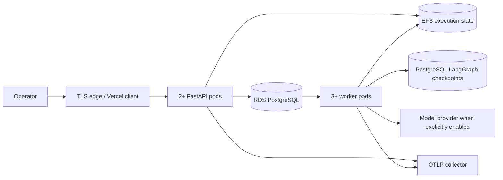

# PostgreSQL, Docker, Kubernetes and AWS foundation

October 14, 2026 verification update. The production foundation is merged through [protected PR #4](https://github.com/Akhilesh-Vangala/verifyops/pull/4) and [current-main CI 38484384448](https://github.com/Akhilesh-Vangala/verifyops/actions/runs/38484384448) at main `0f71effb690e5c3b24c5fe97a1636b1c59f18f45`. It is infrastructure and durability work, not a claim that the application has completed monitored cloud or live-model milestones.

## Resulting topology



PostgreSQL now owns queue admission, idempotency, leases, reviews, events and LangGraph checkpoints when `VDIR_DATABASE_URL` and `VDIR_CHECKPOINT_DATABASE_URL` are configured. SQLite remains the default local adapter so the existing offline workflows and their histories keep working.

## PostgreSQL behavior

`backend/src/vdir/persistence/postgres_jobs.py` implements the existing `JobStore` contract with:

- schema-version verification before the API or worker accepts work;
- advisory transaction locks around idempotency and queue-cap admission;
- `FOR UPDATE SKIP LOCKED` job claims for competing workers;
- owner tokens and lease checks on heartbeat, progress and publication;
- row locks for cancellation, interruption, immutable review and workflow admission;
- explicit failed/interrupted/unknown boundaries rather than automatic paid replay;
- separate liveness (`/healthz`) and database readiness (`/readyz`).

`python -m vdir.persistence.migrations` creates the application schema and the official PostgreSQL LangGraph checkpoint tables. Migrations run as a distinct Compose service and Kubernetes Job. API and worker pods wait for the schema rather than racing startup.

The exported LangGraph runtime selects `AsyncPostgresSaver` only when the checkpoint URL is present. Each application job has a stable thread identity; an exact-version continuation uses its parent's thread. The SQLite checkpointer and receipt behavior remain available for the offline adapter.

## Docker Compose

Compose now runs PostgreSQL, Phoenix/OTLP, one-shot schema migration, FastAPI and an independent queue worker. Application containers run as UID 10001, with a read-only root filesystem, dropped Linux capabilities, `no-new-privileges`, bounded temporary storage and an explicit init process. Python is aligned to 3.12 in local metadata, CI and containers.

```sh
cp .env.example .env
# Set VDIR_ACCESS_TOKEN and VDIR_POSTGRES_PASSWORD privately.
scripts/deployment/compose.sh up --build --wait
curl http://127.0.0.1:8000/healthz
curl http://127.0.0.1:8000/readyz
```

The Compose state volume is still a development integration boundary. Do not infer multi-host artifact durability from a named Docker volume.

## Kubernetes

`infrastructure/kubernetes/base` provides:

- restricted Pod Security namespace;
- distinct API, worker and migration service accounts with token automount disabled;
- two API replicas and three worker replicas;
- rolling updates, resource requests/limits, probes and termination grace;
- PodDisruptionBudgets and API horizontal autoscaling;
- default-deny network policy with declared DNS, PostgreSQL, HTTPS and OTLP egress;
- a `ReadWriteMany` state claim expected to be backed by a managed shared filesystem;
- no checked-in Secret values.

Render the base without a cluster:

```sh
kubectl kustomize infrastructure/kubernetes/base
```

`infrastructure/kubernetes/overlays/kind` supplies a disposable PostgreSQL service, test-only credentials, one API replica, two competing workers and a single-node volume patch. `scripts/deployment/kind_smoke.sh` creates a Kind cluster, builds and loads the runtime image, runs migrations, waits for both deployments, submits an authenticated baseline incident and requires an independently verified completed result.

`infrastructure/kubernetes/overlays/aws` adds an EFS CSI storage class and production-sized base. The ECR URL, immutable image SHA, EFS ID, public origin and runtime Secret are deliberate deployment inputs. Placeholders prevent an accidental false production apply.

## Terraform

`infrastructure/terraform/aws` prepares, but does not apply:

- an encrypted EKS control plane with restricted administrator CIDRs and full control-plane logs;
- an on-demand managed node group;
- immutable/scanned ECR images;
- encrypted/versioned/private S3 artifact storage;
- private encrypted RDS PostgreSQL with backups, logs and optional Multi-AZ;
- encrypted EFS and mount targets for the current workspace contract;
- EFS CSI driver identity through the cluster OIDC provider;
- KMS key rotation, Secrets Manager database material and an AWS budget notification.

```sh
cd infrastructure/terraform/aws
cp terraform.tfvars.example terraform.tfvars
terraform init
terraform fmt -check
terraform validate
terraform plan
```

`terraform apply` is intentionally not part of local or CI verification. It requires an authorized AWS account, real VPC/subnet IDs, bounded administrator CIDRs, alert email, selected region, cost ceiling and review of the plan. Terraform state must use a remote encrypted backend with locking before team or production use.

## CI contract

The required `tests` job starts PostgreSQL and runs the adapter's real concurrency contract. The required `container` job retains the complete container tests and adds the Kind end-to-end deployment smoke. No provider key is required.

## Executed local verification

An isolated PostgreSQL 17.11 installation was initialized under the ignored project tool directory. Schema and official LangGraph checkpoint migrations ran against a disposable database. Concurrent idempotent admission, competing `SKIP LOCKED` claims, workflow admission, expired-lease interruption, immutable review, an authenticated API-to-worker baseline run and a real scripted LangGraph run through `AsyncPostgresSaver` all passed. The complete suite passes **140 tests in 49.843 seconds** with only the opt-in real-dbt test skipped. The existing **96 browser checks**, JavaScript syntax, 362 owned documentation links, Terraform format/init/validation and base/Kind/AWS Kustomize renders also pass.

Actual post-merge Linux CI passes the native PostgreSQL suite, 96 native and 120 container browser checks, dedicated real dbt integration, runtime Docker build, Terraform validation, all Kustomize renders and the real Kind deployment smoke. Logs show the migration Job complete, API deployment ready, two worker pods running and authenticated baseline completion passing independent grading. This confirms container/ephemeral-cluster execution; AWS remains unapplied and the public Vercel service remains read-only. Downloaded exact-head logs/metadata are retained locally under `artifacts/generated/production-foundation-001/`.

Kind runs with its default CNI; this smoke does not establish NetworkPolicy enforcement. A policy-capable staging CNI and dedicated deny/allow tests remain required.

## Remaining release gates

This foundation does not yet complete:

- individual OIDC identity, workspace roles or cross-tenant authorization;
- object-store synchronization that removes the shared POSIX workspace;
- one isolated task per untrusted dbt project;
- a deployed EKS/RDS/EFS environment, TLS/domain wiring or operational alert proof;
- live-model held-out evaluation, user validation or measured production SLOs.

The current Kubernetes architecture is a truthful staging step: distributed coordination is PostgreSQL-backed, while execution artifacts use EFS. Moving immutable artifacts to S3 and isolating each untrusted execution are subsequent security and scalability slices.
