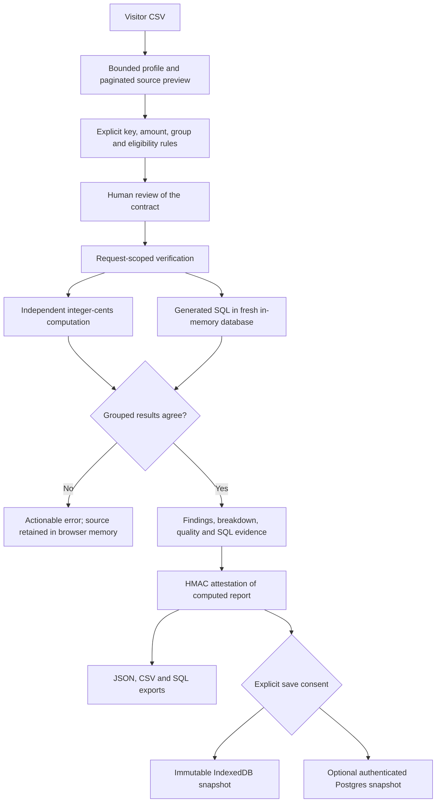

## Multiple tabular formats — October16

CSV, TSV, Excel .xlsx, JSON and JSONL are accepted through the guided product. [Formats, worksheet selection, exact conversion and limits](FILE-IMPORTS.md). Existing domain contracts and result/approval checks remain applicable; PDFs/images are unsupported. Earlier CSV-specific implementation descriptions below remain historical context for the normalized analysis engine.

# Product workspace

VerifyOps turns a suspicious transaction total into an inspectable reconciliation. A visitor brings an export, reviews its business definition, compares an independent reference with generated SQL, and keeps a checked report. The public calculation is deterministic. It does not call a live model, infer unstated business semantics or deploy a warehouse patch.

## Pages and workflow

| Page | Purpose |
| --- | --- |
| `/` | Product introduction, sample walkthrough, clear path to an investigation |
| `/workspace` | Actual saved-work counts, recent investigations, empty state |
| `/uploads`, `/workspace/new` | Source → Business rules → Review → Results |
| `/workspace/history` | Search and filter explicit snapshots; open or delete |
| `/workspace/projects` | Create named groups; inspect their investigations |
| `/workspace/investigations/<uuid>?storage=device` | Reloadable device snapshot; cloud uses `storage=cloud` |
| `/workspace/settings` | Storage disclosures, export/restore device backup, delete device history |
| `/workspace/login` | Genuine provider sign-in when configured; otherwise an explicit unavailable state |
| `/workspace/guide` | Contracts, source preparation, limits and interpretation |
| `/demo` | Existing six-incident guided synthetic repair application |

Browser Back/Forward and direct detail URLs work. The app uses native ES modules and semantic HTML; there is no additional frontend server or framework runtime. A monochrome design system, responsive sidebar/navigation, keyboard-operated report tabs, command palette, native dialogs, focus management, screen-reader announcements and reduced-motion styles support the workflow. Automated accessibility checks are regression evidence, not a comprehensive accessibility certification.

## Source and recovery

File selection and drag/drop use the same bounded UTF-8 CSV path. The preview shows logical CSV record numbers, with the header counted as record 1; quoted multiline records are not physical line numbers. Search, pagination and selected-error-record inspection make later records reachable. Missing values, distinct counts and numeric counts expose assumptions before mapping. No raw row is silently corrected.

Conflicting keys and invalid amounts identify up to 20 record/column issues with corrective guidance; issue responses omit raw cell values. A network interruption leaves the source and contract available for retry. SSE stage events correspond to actual source, contract, reference, SQL, reconciliation and report callbacks. There are no fabricated percentages. Stop waiting aborts the browser wait; a bounded read-only server thread may finish. This is not a durable background job or a cross-instance admission queue.

The report leads with the checked total and a conditional finding. Duplicate impact is said to explain the reported discrepancy only when the declared reported total matches the raw eligible sum. Otherwise the UI avoids attributing an unexplained delta to duplicates. A grouped chart and paginated table, duplicate record locations, normalization bindings, exact SQL, independent check outcomes and source fingerprint remain inspectable. The result is conditional on the declared grain, currency and eligibility rules.

## Storage and report authenticity

Unsaved source/rules/results stay in browser memory and are processed request by request. They are not deliberately logged or added to shared server history. Hosting metadata can remain with the host. Explicit device saving stores the source CSV, rules and report in this browser's IndexedDB; it does not synchronize devices and may be cleared by browser cleanup. The active clear action and saved-history deletion are separate confirmed actions. Each save creates a distinct snapshot; edits never silently replace an existing saved result. Device investigation saves enforce a 50-snapshot bound inside a write transaction. Exported backups contain business data and need appropriate handling. Restore asks for consent before submitting sources for bounded validation. It creates new device IDs, validates each retained source, authenticates matching reports and returns unverifiable reports to drafts. A single IndexedDB transaction imports the whole bundle or none of it; current snapshots are preserved. This provides deliberate cross-browser transfer without claiming automatic synchronization.

Successful reports receive a purpose-bound HMAC over canonical report JSON. Opening a saved report checks this signature with the server before displaying a verified result; modified, unverifiable or old-key reports return to a draft/re-run path. This authenticates a past calculation, not the truth of the source system, a fresh warehouse observation or the identity of the person who uploaded it. Keep `VDIR_REPORT_SIGNING_KEY` stable and private (48+ characters), or reuse the public deployment's existing `VDIR_DEMO_SECRET`. Without either, local signing is process-ephemeral. Rotation invalidates old receipts; re-run retained source. Device snapshots themselves are editable by their device owner; they are not a tamper-proof audit ledger.

## Optional cloud accounts

**Cloud accounts are disabled on a deployment until its real service is configured.** No placeholder login or successful cloud-save simulation is exposed. The adapter delegates identity checks and sessions to Supabase Auth and sends PostgREST requests using the authenticated user's token. A service-role/admin key is explicitly refused. Provider tokens live in Secure, HttpOnly, SameSite=Strict, host-only cookies on HTTPS; passwords are neither stored in the browser nor returned in validation errors. Refresh rotates provider sessions. Sign-out clears browser cookies even if provider revocation fails and discloses that limitation.

Apply [the migration](../../infrastructure/supabase/migrations/001_product_workspace.sql) as the owner of a dedicated Supabase database, then privately configure `VDIR_SUPABASE_URL` and `VDIR_SUPABASE_PUBLISHABLE_KEY` for the intended environment. Use a publishable key or legacy `anon` key, never a secret/service-role key. Do not point test scripts at a customer database. Enable password auth, choose provider password/rate policies, configure the correct Site URL and allowed confirmation redirects, email confirmation and a working mail service. Registration stays disabled unless `VDIR_ACCOUNT_SIGNUP=1`; account creation/email delivery must be rehearsed against the real configured provider before calling it deployed functionality. Vercel preview and production configuration are separate.

The migration enables and forces owner RLS, revokes anonymous table access and grants authenticated SELECT/INSERT/DELETE only. There is no UPDATE grant. Composite owner/project keys prevent attaching a snapshot to someone else's project. Parent deletion clears lineage only. Per-owner advisory locks enforce maximum 20 projects and 100 investigations under concurrent inserts. Owner identity is checked before locking. Application history/detail/delete requests additionally filter the provider-validated owner. These are individual accounts, not an organization/SSO/RBAC implementation.

Saving to cloud separately asks whether to retain the CSV. Report-only snapshots omit source, sample cells and raw previews; reports still contain aggregate business data, column names and duplicate record locations. A completed cloud report is recomputed server-side rather than accepting client-supplied verification flags. Drafts without a retained source require re-uploading the original matching SHA-256 before continuing. Source-preserving snapshots can resume from the configured account. Provider backups, deletion retention, monitoring, WAF/rate policy, account recovery and production restore/load evidence require operational validation; SQL files alone do not establish them.

## Verification

- `backend/tests/api/test_product.py`: structured late-record errors, preview bounds, real SSE outcomes, signed-report tampering, controlled provider transport/session and storage-authority checks.
- `scripts/demos/product_browser.py`: actual Chromium file selection, consent, immutable snapshots, reload, tamper rejection, network retry, record inspection, keyboard navigation and 320–1440 px layouts. Optional pinned axe-core scan; human feedback remains separate.
- `scripts/checks/product_rls.py`: actual migration, two-owner access checks, anonymous denial, immutable writes and concurrent quota checks in an automatically created/dropped PostgreSQL test database. Requires an explicitly provided **test** administrative URL.
- Existing private operator, graph, automation, dbt, sample-demo and upload regressions remain required. Protected CI executes the repository's required `tests`, `container` and `dbt` jobs on the reviewed head.

Provider references: [password auth](https://supabase.com/docs/guides/auth/passwords), [sessions](https://supabase.com/docs/guides/auth/sessions), [API grants and authorization](https://supabase.com/docs/guides/api/securing-your-api), [row-level security](https://supabase.com/docs/guides/database/postgres/row-level-security), [Auth REST specification](https://github.com/supabase/auth/blob/master/openapi.yaml).
