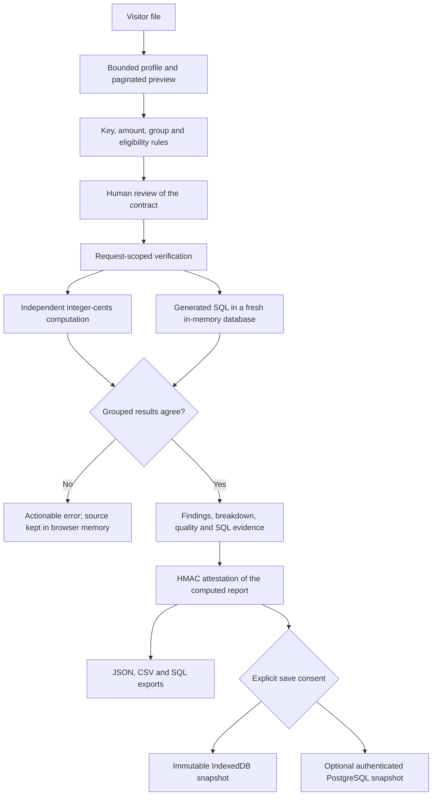

# Product workspace

The product workspace (`frontend/apps/product`) turns a suspicious transaction total into an inspectable reconciliation. A visitor brings an export, reviews its business definition, compares an independent reference with generated SQL and keeps a checked report. The public calculation is deterministic and makes no model call. [Data imports](DATA-IMPORTS.md).

## Pages

| Page | Purpose |
| --- | --- |
| `/` | Product introduction, sample walkthrough and entry to an investigation |
| `/workspace` | Saved-work counts, recent investigations and empty state |
| `/uploads`, `/workspace/new` | Source, business rules, review and results |
| `/workspace/history` | Search, filter, open or delete saved snapshots |
| `/workspace/projects` | Named groups of investigations |
| `/workspace/investigations/<uuid>?storage=device` | Reloadable device snapshot; cloud snapshots use `storage=cloud` |
| `/workspace/settings` | Storage disclosures, device backup export and restore, history deletion |
| `/workspace/login` | Provider sign-in when configured; otherwise an explicit unavailable state |
| `/workspace/guide` | Contracts, source preparation, limits and interpretation |
| `/demo` | Guided six-incident synthetic repair sandbox |

The app uses native ES modules and semantic HTML with no frontend build or server runtime. It supports Back/Forward and direct detail URLs, a responsive sidebar, keyboard-operated report tabs, a command palette, native dialogs with focus management, screen-reader announcements and reduced-motion styles. Automated axe-core checks are regression evidence, not an accessibility certification.

## Source and recovery

File selection and drag-and-drop share one bounded path. The preview shows logical record numbers, with the header as record 1, so quoted multiline records are not physical line numbers. Search, pagination and error-record inspection make later records reachable. Missing values, distinct counts and numeric counts are shown before mapping, and no row is silently corrected.

Conflicting keys and invalid amounts identify up to 20 record and column issues with corrective guidance, without echoing cell values. A network interruption keeps the source and contract available for retry. Server-sent events correspond to the real source, contract, reference, SQL, reconciliation and report stages. Stopping the wait aborts the browser request; a bounded read-only server thread may still finish.

The report leads with the checked total and a conditional finding. Duplicates are said to explain the discrepancy only when the declared reported total equals the raw eligible sum. A grouped chart and paginated table, duplicate record locations, normalization bindings, exact SQL, check outcomes and the source fingerprint stay inspectable. Every result is conditional on the declared grain, currency and eligibility rules.

## Storage and report authenticity

Unsaved sources, rules and results stay in browser memory and are processed per request; they are not written to shared server history. Explicit device saving stores the source, rules and report in this browser's IndexedDB. It does not synchronize devices and can be removed by browser cleanup. Each save creates a distinct snapshot, edits never replace a saved result, and device saves are capped at 50 snapshots inside a write transaction.

Device backups contain business data. Restore asks for consent, revalidates every source, authenticates matching reports, returns unverifiable reports to drafts and assigns new IDs in one IndexedDB transaction, so a bundle imports completely or not at all.

Successful reports carry a purpose-bound HMAC over canonical report JSON. Opening a saved report checks the signature with the server; modified or old-key reports return to a draft. This authenticates a past calculation, not the truth of the source system or the uploader's identity. Set `SQLARBITER_REPORT_SIGNING_KEY` (48 or more characters) or reuse `SQLARBITER_DEMO_SECRET`; without either, signing keys are process-ephemeral. Rotating the key invalidates old receipts.

## Cloud accounts

Cloud accounts are disabled unless `SQLARBITER_SUPABASE_URL` and `SQLARBITER_SUPABASE_PUBLISHABLE_KEY` are set; no simulated login exists. Identity and sessions are delegated to Supabase Auth, and PostgREST requests use the signed-in user's token. Service-role keys are refused. Tokens live in Secure, HttpOnly, SameSite=Strict, host-only cookies, refresh rotates sessions, and sign-out clears cookies even if provider revocation fails. Registration is off unless `SQLARBITER_ACCOUNT_SIGNUP=1`.

Apply [the migration](../../infrastructure/supabase/migrations/001_product_workspace.sql) as the owner of a dedicated Supabase database and use a publishable or `anon` key. Configure password auth, rate limits, the Site URL, confirmation redirects and email delivery in the provider.

The migration enables and forces owner row-level security, revokes anonymous access and grants authenticated `SELECT`, `INSERT` and `DELETE` only, with no `UPDATE`. Composite owner and project keys prevent attaching a snapshot to another user's project. Per-owner advisory locks enforce 20 projects and 100 investigations under concurrent inserts. These are individual accounts, not organizations, SSO or RBAC.

Saving to the cloud asks separately whether to keep the source. Report-only snapshots omit the source, sample cells and previews, though reports still contain aggregates, column names and duplicate locations. Completed cloud reports are recomputed on the server instead of trusting client verification flags. A draft without a retained source requires the matching original file, checked by SHA-256, before it continues.

## Verification

- `backend/tests/api/test_product.py`: late-record errors, preview bounds, SSE outcomes, signed-report tampering, provider transport and session handling, and storage authority.
- `scripts/demos/product_browser.py`: Chromium file selection, consent, immutable snapshots, reload, tamper rejection, network retry, record inspection, keyboard navigation and layouts from 320 to 1440 pixels, with an optional axe-core scan.
- `scripts/checks/product_rls.py`: applies the migration in a temporary PostgreSQL database and checks two-owner isolation, anonymous denial, immutable writes and concurrent quotas. It requires an explicit test administrator URL.

Provider references: [password auth](https://supabase.com/docs/guides/auth/passwords), [sessions](https://supabase.com/docs/guides/auth/sessions), [API authorization](https://supabase.com/docs/guides/api/securing-your-api), [row-level security](https://supabase.com/docs/guides/database/postgres/row-level-security).
