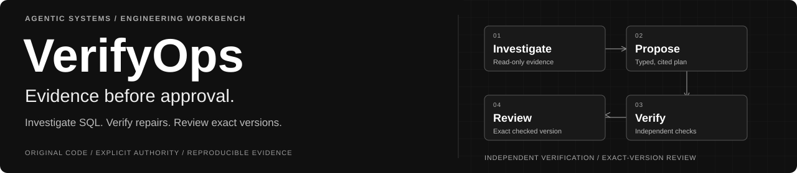
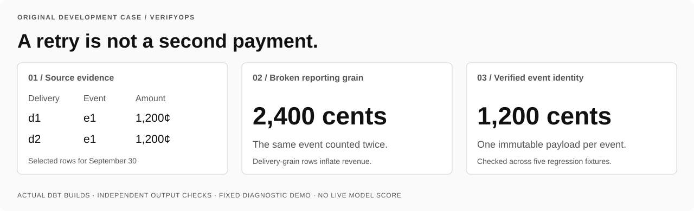
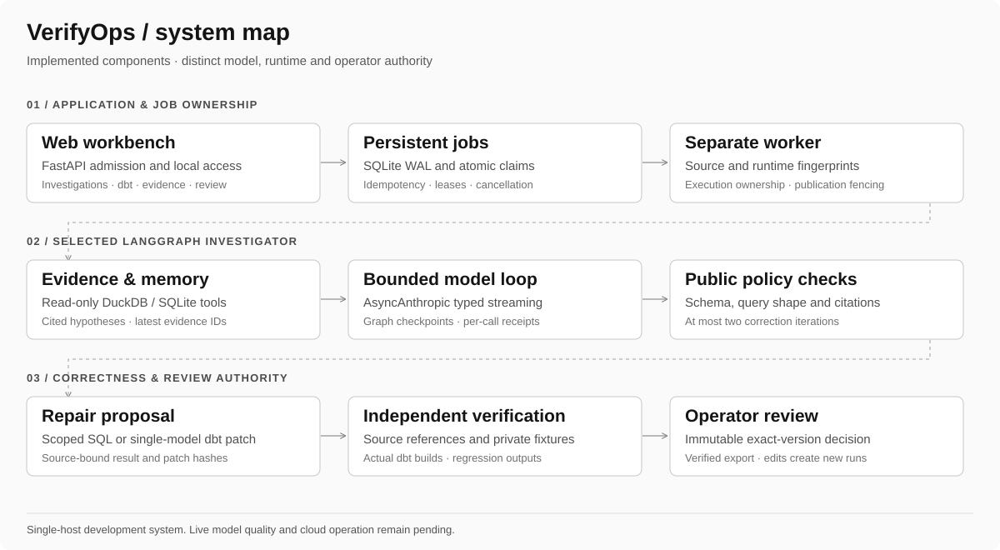
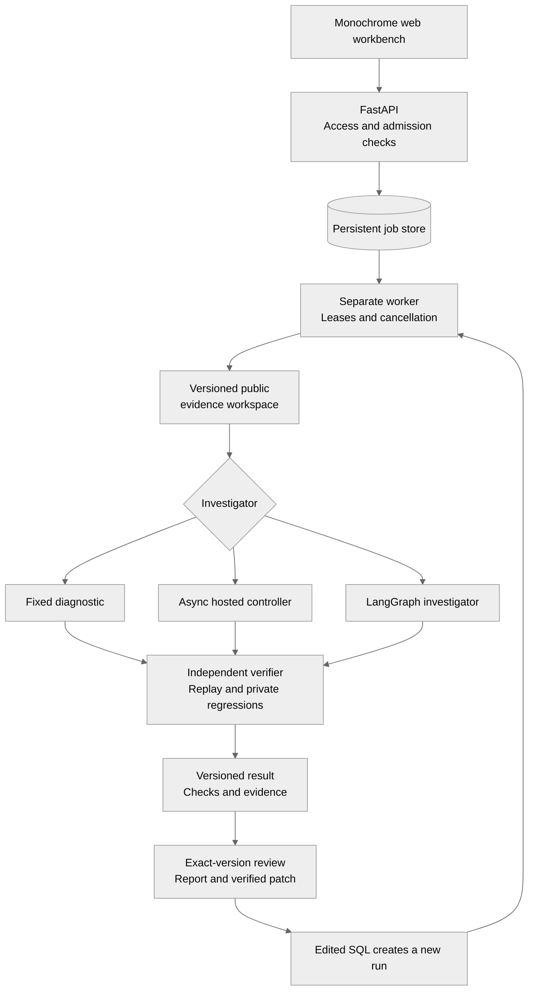
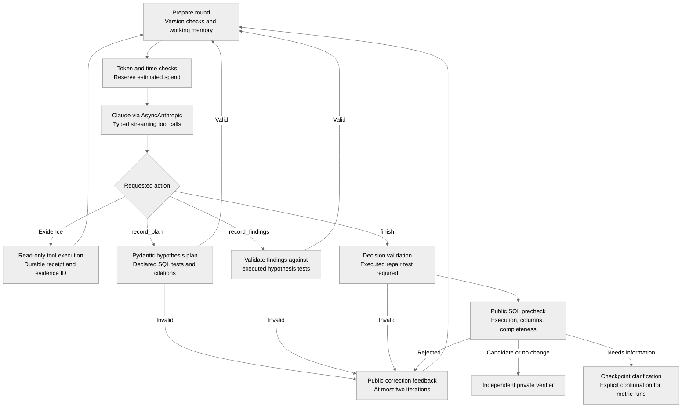
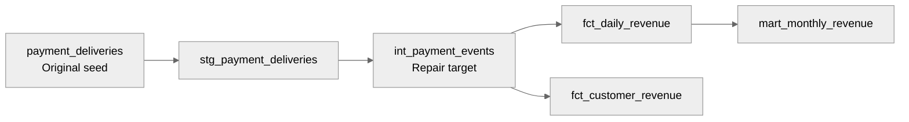
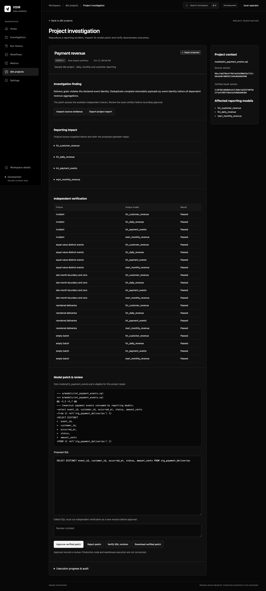
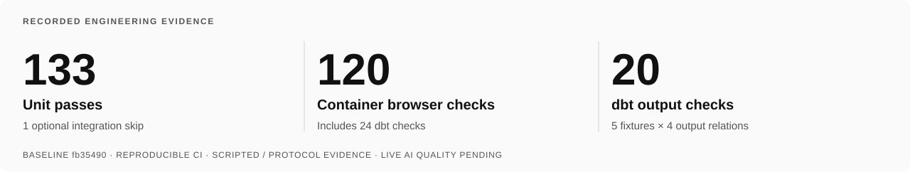

> Historical record. [Current project overview](../../../README.md) and [current handoff](../HANDOFF.md) take precedence.

<p align="center">
  
</p>

<p align="center">
  <a href="https://github.com/Akhilesh-Vangala/verifyops/actions/workflows/checks.yml"></a>
  &nbsp; Python 3.12 · LangGraph · PostgreSQL · Kubernetes · dbt
</p>

<p align="center">
  <a href="docs/CASE-STUDY.md">Case study</a> ·
  <a href="https://verifyops.vercel.app">Working app</a> ·
  <a href="docs/DEMO.md">Recorded demo</a> ·
  <a href="#the-agentic-workflow">Agent workflow</a> ·
  <a href="#a-real-dbt-repair-workflow">dbt demo</a> ·
  <a href="#run-locally">Quick start</a> ·
  <a href="#verified-evidence">Evidence</a> ·
  <a href="docs/README.md">Technical documentation</a>
</p>

# VerifyOps

**Investigate a broken business metric. Propose an evidence-backed SQL repair. Independently verify it before human review.**

VerifyOps combines a checkpointed LangGraph investigator, bounded analytical tools and a real dbt repair pipeline. Independent checks accompany every proposal; edits trigger new verification, and reviews bind to the exact checked version.

> **Development release.** The [public Vercel app](https://verifyops.vercel.app/demo) runs an interactive guided sandbox with actual verification. [Watch the continuous recording](https://verifyops.vercel.app/demo/recording). PostgreSQL coordination, Docker Compose, Kubernetes/Kind and unapplied AWS Terraform now form the production foundation. Live AI quality, individual identity, isolated customer execution, monitored AWS operation and user feedback remain pending. Approval records review; production writes and repository merges are not connected. [Production foundation →](../../operations/PRODUCTION-FOUNDATION.md)

| Run the product | Inspect the engineering | Challenge the evidence |
| --- | --- | --- |
| [Interactive app](https://verifyops.vercel.app) · [Quick start](#run-locally) · [Recorded walkthrough](../../DEMO.md) | [Design case study](../../architecture/CASE-STUDY.md) · [System map](../../README.md) | [Reproducible checks](../../../.github/CONTRIBUTING.md) · [Limits and tradeoffs](../../architecture/CASE-STUDY.md#what-the-evidence-establishes) |

## Try it and watch it

[**Open the interactive app →**](https://verifyops.vercel.app/demo) · [**Watch the continuous recording →**](https://verifyops.vercel.app/demo/recording) · [Recording file](../../../frontend/apps/demo/assets/media/walkthrough.webm)


Choose an incident → run the original fixed investigator and source-level verifier → inspect SQL/evidence → submit a SQL revision → run regression checks again → accept or reject the exact checked result. The recorded SUM(DISTINCT) false repair fails independent checks and cannot be accepted.

**Actual calculations, guided synthetic data, no model charges.** Browser-local history and signed version checks support the public flow. Persistent private workers and live-model evaluations are separate. [Public architecture and limits](../../operations/PUBLIC-SANDBOX.md) · [Recording provenance](../../demos/history/2026-10-14-interactive-recording.json).

## The private dbt workbench

<picture>
  <source media="(prefers-reduced-motion: reduce)" srcset="../../assets/demos/verifyops-demo-poster.png">
  
</picture>

**17-second recorded walkthrough.** Actual dbt builds and application execution on original synthetic data with the fixed diagnostic. Reviews are automated sandbox demonstrations. No live model inference, production warehouse write or repository merge. [Static frames and recording provenance →](../../DEMO.md)

The operator journey connects a queued investigation to source evidence, a SQL diff, independent regression checks and an immutable review. The native web app uses monochrome styling throughout. The sample shown uses original synthetic data and the fixed diagnostic.

## The business problem

<picture>
  <source media="(prefers-color-scheme: dark)" srcset="../../assets/branding/verifyops-case-dark.svg">
  
</picture>

A dashboard can return plausible numbers while its transformations are semantically wrong: a join multiplies revenue, retries duplicate payment events, or timestamp handling shifts transactions into the wrong reporting day. Successful SQL execution alone cannot establish that the metric is correct.

VerifyOps makes this investigation reviewable: collect source evidence, test hypotheses, propose a restricted repair, compare outputs against independent source calculations and regression fixtures, then present the SQL diff and verification record to an operator.

| Investigation | Evidence and expected behavior |
| --- | --- |
| Versioned-product join inflation | Inspect join multiplicity and propose a repair that preserves the reporting contract. |
| Repeated payment deliveries | Restore event identity while retaining separate events with equal amounts. |
| UTC reporting boundaries | Test explicit offsets; request missing authoritative offsets instead of inventing them. |
| Conflicting event payloads | Identify the information gap and request authoritative source data. |
| Healthy transformation | Return a verified no-change decision. |
| dbt payment-revenue incident | Repair one upstream model and check canonical, daily, monthly, and customer outputs. |

## Engineering contribution

The owned work connects **bounded agent investigation**, **executed and cited evidence**, **independent correctness checks**, and **exact-version review**. The SDK handles model transport; application code owns job leases, call receipts, estimated spend admission, SQL/tool limits, dbt patch restrictions and result integrity. [Design decisions, failure cases and implementation entry points →](../../architecture/CASE-STUDY.md)

## System architecture



<details>
<summary><strong>Expand application orchestration and ownership</strong></summary>



</details>

The worker owns job execution. LangGraph owns investigation transitions. The verifier owns correctness checks. The operator owns review. [Full flowcharts and authority boundaries →](../../architecture/SYSTEM-FLOWCHARTS.md)

## The agentic workflow

The `langgraph` investigator uses an owned **vdir-graph-3** StateGraph. It separates model calls, source evidence, structured plans, findings, public prechecks, and clarification into checkpointed transitions.

<details>
<summary><strong>Expand the checkpointed agent flow</strong></summary>



</details>

| Agent capability | Implemented behavior |
| --- | --- |
| **Structured planning** | Strict Pydantic schemas; up to three hypotheses per plan and three plan revisions. Repairs require a cited successful execution of a test from the latest plan. |
| **Evidence-cited findings** | Supports, contradicts, or inconclusive assessments must reference complete query results matching the hypothesis test. Interpretations remain unverified. |
| **Public working memory** | Latest plan, current findings, and the latest 12 evidence identifiers. Original transcripts remain retained; this is not context compaction. |
| **Bounded correction** | At most two public-feedback corrections within the original round, tool, token, and time budgets. |
| **Durable investigation state** | SQLite graph checkpoints plus per-call receipts. Completed receipts support explicit recovery; unresolved calls block automatic replay. |
| **Human clarification** | Version-checked metric continuation creates a child run while preserving the parent and consumed budgets. dbt clarification currently requires a fresh controlled run. |

**Evidence tools:** `contract`, `describe`, `profile`, `lineage`, `changes`, `current_sql`, `query`, `inspect_sql`, `check_join`, and `project` when dbt context is available. `record_plan`, `record_findings`, and `finish` are workflow controls rather than source evidence.

DuckDB is the default analytical engine; SQLite is also supported. SQLGlot restricts queries to the permitted read-only surface. Tools enforce row, column, cell, byte, execution-time, and memory bounds. A public SQL precheck establishes execution and output shape; separate references and private regressions check business outputs.

[Agent orchestration](../../architecture/AGENT-ORCHESTRATION.md) · [Findings and working memory](../../architecture/WORKFLOWS.md) · [AI design](../../architecture/AI-DESIGN.md)

## A real dbt repair workflow

The original payment-revenue project contains five models. An intentionally defective intermediate emits delivery-grain rows: retries inflate September 30 revenue from **1,200 to 2,400 cents**. The models build, but the event-grain test fails.



The worker runs actual `dbt seed`, `run`, and `test`; exports staging evidence and manifest/model context; invokes the selected investigator; then validates a restricted single-model patch. Fresh dbt builds across **five designed fixtures** independently check **four output relations**, producing **20 model checks**. The fixed diagnostic repair restores daily revenue to **1,200 cents**. An equal-value false fix passes the original incident but fails regression.

<details>
<summary><strong>View the actual verified repair, regression checks, SQL diff, and review screen</strong></summary>



These screenshots use original synthetic development data and the fixed diagnostic. They show real application/dbt execution, not a live model result. The UI currently retains the earlier VDIR name.

</details>

Use `/dbt` to browse the trusted project, `/dbt/new` to start a run, and `/dbt/runs/{id}` to inspect progress, evidence, impact, checks, and the diff. Editing SQL creates a new verification job. Failed or tampered results cannot be approved or downloaded as verified patches.

[Browser workflow and API](../../architecture/DBT-WORKFLOW.md) · [Patch restrictions and spend accounting](../../architecture/SPENDING-AND-DBT.md)

## Operational controls

| Boundary | Current controls |
| --- | --- |
| Model execution | 8 rounds; 24 evidence calls; at most 3 identical calls; 2,048 requested output tokens per round and 12,000 total. |
| Context | 16,000 counted input tokens per request; 64,000 cumulative counted input tokens; 250 KB serialized provider request. |
| SQL tools | Up to 100 rows, 50 columns, 256 characters per cell, and 32 KB per result; bounded 3-second queries and DuckDB memory. |
| Spending | Atomic estimated reservations; defaults of $1 per investigation workspace and $5 cumulative ledger allowance. Unknown usage retains reservations; real generation retries are disabled. These are not provider invoice caps. |
| Queue and ownership | At most 16 active jobs; idempotent admission, atomic claims, renewable leases, heartbeat checks, and cancellation-aware publication. |
| Review integrity | Exact result versions; immutable review records; dbt report/model/patch hashes checked before approval and download. |
| Observability | OpenTelemetry spans across jobs, graph stages, model calls, tools, and verification; local JSONL and optional OTLP/Phoenix. Prompt and row contents are not exported to Phoenix. |

SQLite remains the default offline adapter. PostgreSQL coordination/checkpoints and Kubernetes packaging are implemented for the production foundation; individual identity, object-store workspace synchronization, per-investigation OS isolation, realistic connectors and monitored AWS operation remain release work.

## Run locally

Requires Python **3.11 or 3.12**; CI and the container use **3.12**. From a fresh checkout:

```sh
git clone https://github.com/Akhilesh-Vangala/verifyops.git
cd verifyops
python3.12 -m venv .venv
.venv/bin/python -m pip install -r backend/requirements-dev.txt
python3.12 -m venv .venv-dbt
.venv-dbt/bin/python -m pip install -r backend/requirements-dbt.txt
PYTHONPATH=backend/src .venv/bin/python -m vdir.serve
```

Open **http://127.0.0.1:8000** or **http://127.0.0.1:8000/dbt**. The launcher starts the API and a separate worker; local runs and reviews persist under `artifacts/generated/app`. dbt dependencies use their own environment because their dependency constraints differ from the app. Fixed investigations need no provider credentials.

For hosted or LangGraph investigations, create a private `.env` from `.env.example` **on a fresh checkout**, then configure `ANTHROPIC_API_KEY` and `VDIR_ANTHROPIC_MODEL` locally. The app loads it without overriding existing process variables. Explicit AI selections make billable calls and require a matching trusted pricing profile. Never commit the key or overwrite an existing private configuration.

<details>
<summary><strong>Containers and optional Phoenix tracing</strong></summary>

```sh
docker build --target test -t verifyops:test .
docker run --name verifyops-check verifyops:test
# Configure VDIR_ACCESS_TOKEN privately: at least 32 characters.
docker compose up --build -d
```

Compose runs the API, worker, and Phoenix with loopback ports and shared local volumes. The runtime includes isolated dbt tooling. Container execution is verified through CI; public cloud deployment is pending. See [setup and deployment](../../operations/DEVELOPMENT.md).

</details>

## Verified evidence

<picture>
  <source media="(prefers-color-scheme: dark)" srcset="../../assets/branding/verifyops-evidence-dark.svg">
  
</picture>

The implementation baseline at [`14f0bce`](https://github.com/Akhilesh-Vangala/verifyops/commit/14f0bce060eec328e46e95ace58c153559015a91) passed all three jobs in [GitHub Actions run 38315249531](https://github.com/Akhilesh-Vangala/verifyops/actions/runs/38315249531). The badge above tracks the current branch; the following counts belong to that recorded baseline.

| Evidence | Recorded result | Meaning |
| --- | --- | --- |
| Unit suite | 133 passed; 1 optional dbt integration skipped in each workbench job | Protocol, ownership, bounds, review, spending, and verification behavior. |
| Browser suites | 96 native checks; 120 container checks including 24 dbt checks | Actual application journeys, responsive pages, revisions, cancellation, and review. |
| Dedicated dbt job | Real integration test, CLI repair, and 24 browser checks passed | Actual dbt execution and five-fixture/four-relation verification. |
| Fixed synthetic benchmark | 38/38 known development cases | Contract-specific diagnostic and evaluation plumbing; not live AI accuracy or unseen generalization. |
| Container packaging | Test image execution and runtime build passed | Reproducible packaging; not cloud operation or production readiness. |

Actions publishes downloadable browser, container, and dbt evidence. Generated runtime state and reports stay out of Git. Live model comparisons, held-out/safety evaluation, actual operator/customer feedback, and cloud monitoring remain pending.

## Reproduce checks and evaluation

```sh
.venv/bin/python -m playwright install chromium
VDIR_LOAD_DOTENV=0 PYTHONPATH=backend/src .venv/bin/python -m unittest discover -s backend/tests -v
VDIR_LOAD_DOTENV=0 PYTHONPATH=backend/src .venv/bin/python tests/e2e/browser_smoke.py
VDIR_LOAD_DOTENV=0 PYTHONPATH=backend/src .venv/bin/python tests/e2e/browser_graph_smoke.py
VDIR_LOAD_DOTENV=0 PYTHONPATH=backend/src .venv/bin/python tests/e2e/browser_automation_smoke.py
VDIR_LOAD_DOTENV=0 PYTHONPATH=backend/src .venv/bin/python tests/e2e/browser_pages_smoke.py
VDIR_LOAD_DOTENV=0 PYTHONPATH=backend/src .venv/bin/python tests/e2e/browser_dbt_smoke.py
VDIR_RUN_DBT_TESTS=1 VDIR_LOAD_DOTENV=0 PYTHONPATH=backend/src .venv/bin/python -m unittest discover -s backend/tests -p test_dbt_integration.py -v
VDIR_LOAD_DOTENV=0 PYTHONPATH=backend/src .venv/bin/python -m vdir.benchmark --output artifacts/generated/benchmark-run --samples 3
```

Use a fresh benchmark output directory. Reports expose Pass@1/Pass@3, SQL execution accuracy, tool calls, rounds, tokens, latency, failures, and configured cost estimates. Insufficient attempts or unknown live costs yield `null`.

A separately configured, billable LangGraph smoke run:

```sh
PYTHONPATH=backend/src .venv/bin/python -m vdir --investigate artifacts/generated/live-graph-six --investigator langgraph --engine duckdb
```

## Technology and repository map

| Layer | Technology and source |
| --- | --- |
| Agent orchestration | LangGraph + PostgreSQL/SQLite checkpointers · [`investigator_runtime/graph.py`](../../../backend/agents/investigator/graph.py) |
| Model transport | Official AsyncAnthropic SDK · [`investigator_runtime/model.py`](../../../backend/agents/investigator/model.py) |
| Typed plans/findings | Pydantic · [`investigator_runtime/agent_policy.py`](../../../backend/agents/investigator/agent_policy.py) |
| Analytical tools | DuckDB / SQLite + SQLGlot · [`investigator_runtime/tools.py`](../../../backend/agents/investigator/tools.py), [`engines.py`](../../../backend/agents/investigator/engines.py) |
| Independent verification | Python references and evidence replay · [`backend/src/vdir/evaluation.py`](../../../backend/src/vdir/evaluation/evaluation.py), [`reference.py`](../../../backend/src/vdir/verification/reference.py) |
| API, worker, state | FastAPI + Uvicorn + PostgreSQL/SQLite adapters · [`backend/src/vdir/api.py`](../../../backend/src/vdir/api/routes.py), [`postgres_jobs.py`](../../../backend/src/vdir/persistence/postgres_jobs.py), [`jobs.py`](../../../backend/src/vdir/persistence/jobs.py) |
| dbt repair | dbt-core + dbt-duckdb · [`backend/src/vdir/dbt_workflow.py`](../../../backend/src/vdir/workflows/dbt_workflow.py), [`original project`](../../../backend/dbt/revenue_incident) |
| Spend accounting | SQLite ledger · [`backend/src/vdir/spending.py`](../../../backend/src/vdir/platform/spending.py) |
| Web application | Native HTML / CSS / JavaScript · [`frontend/workbench`](../../../frontend/apps/workbench) |
| Tracing and delivery | OpenTelemetry/Phoenix, Docker, Kubernetes/Kind, Terraform/AWS, GitHub Actions, Playwright |

## Repository map

```text
verifyops/
├── investigator_runtime/  Owned agent graph, SDK transport and analytical tools
├── backend/src/vdir/              API, job worker, verification, dbt workflow and web app
├── dbt/                   Original payment-revenue incident and regression fixtures
├── tests/                 Protocol, queue, integrity and browser suites
├── deploy/                Kustomize bases/overlays and unapplied AWS Terraform
├── docs/                  Design, evaluation, delivery and original visual assets
├── .github/               Native, container and dbt checks; review templates
└── CONTRIBUTING.md        Reproduction and evidence conventions
```

## Explore the design

| Read | Purpose |
| --- | --- |
| [Documentation index](../../README.md) | Routes through implementation, evidence, tradeoffs and release gates. |
| [Full system flowcharts](../../architecture/SYSTEM-FLOWCHARTS.md) | Application, AI layers, evidence tools, dbt repair, and operational boundaries. |
| [Architecture](../../architecture/OVERVIEW.md) · [AI design](../../architecture/AI-DESIGN.md) | Separation of investigation, verification, and review. |
| [Agent orchestration](../../architecture/AGENT-ORCHESTRATION.md) · [Workflows](../../architecture/WORKFLOWS.md) | Checkpoints, findings, clarification, ownership, and cancellation. |
| [dbt browser workflow](../../architecture/DBT-WORKFLOW.md) · [Spending and dbt](../../architecture/SPENDING-AND-DBT.md) | Routes, patch restrictions, regressions, and cost admission. |
| [Evaluation](../../evaluation/README.md) · [Benchmark](../../evaluation/BENCHMARK.md) | Known-case evidence, metrics, and evaluation limitations. |
| [Setup/deployment](../../operations/DEVELOPMENT.md) · [Application pages](../../architecture/APPLICATION-PAGES.md) | Reproduction, configuration, and product navigation. |
| [Production foundation](../../operations/PRODUCTION-FOUNDATION.md) | PostgreSQL fencing, Docker Compose, Kubernetes/Kind and AWS Terraform boundaries. |
| [Decisions](../../DECISIONS.md) · [Plan](../PLAN.md) · [Progress](../PROGRESS.md) | Tradeoffs, completed work, and remaining release gates. |
| [README history](FOUNDATION-README.md) | Preserved dated milestones from the previous README. |

The Python package and some UI labels retain the earlier **Verified Data Incident Resolution / VDIR** name. The public project is **VerifyOps**.

[Branch and release workflow](../../development/BRANCHING.md) · [Contributing](../../../.github/CONTRIBUTING.md)
